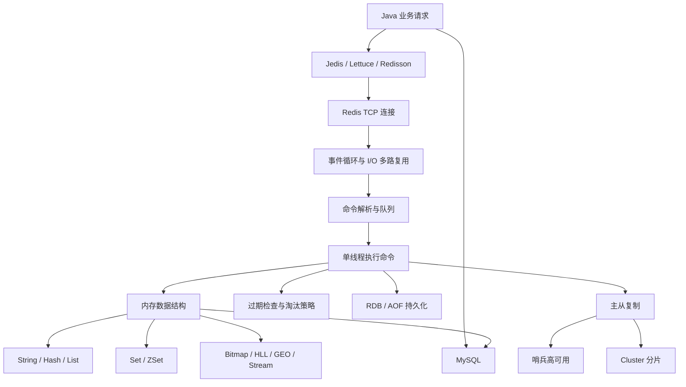
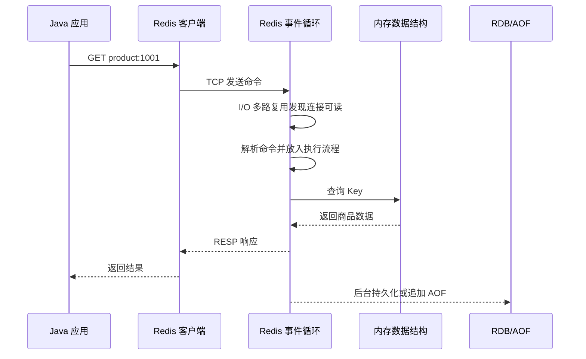

# Redis 串联学习：2026 深度面试录制版

> 适用：Redis 6/7 面试复述、知识点录制、短视频口播。
> 统一场景：商品详情缓存 + 秒杀库存 + 分布式锁。
> 讲解方式：先说 Redis 解决什么问题，再沿着一次请求讲清内部原理。

## 一、录制提示词

```text
请围绕“商品详情缓存、秒杀库存和分布式锁”这个真实业务场景，把 Redis 6/7 的核心知识串成一条因果链。

不要按 String、Hash、RDB 等名词孤立罗列，要先给出 Redis 的整体架构，再说明每个组件解决什么问题、请求如何流转、组件之间如何配合。
重点覆盖：Redis 为什么快、I/O 多路复用、单线程事件循环、SDS、哈希表、跳表、String/Hash/List/Set/ZSet、Bitmap、HyperLogLog、GEO、Stream、RDB、AOF、混合持久化、过期删除、内存淘汰、缓存穿透/击穿/雪崩/一致性、分布式锁、SET NX EX、Lua、Redisson、事务、Pipeline、发布订阅、主从复制、哨兵、Cluster 和分片。

输出结构：
1. Redis 架构总图和总主线；
2. 可直接口播的深度讲解；
3. 高频面试题的 30 秒回答；
4. 完整录制稿、1 分钟版、最短急救版和录制前速背卡。

语言要像面试现场，先结论后原因。特别注意：Redis 的核心命令执行主要是单线程，但后台持久化、网络处理和部分异步任务不能笼统说成全部由主线程完成。
```

## 二、先记住 Redis 的架构地图



### 一条业务总主线

```text
用户访问商品
 -> 应用先查 Redis
 -> 命中则直接返回
 -> 未命中再查 MySQL 并回填 Redis
 -> 秒杀扣库存使用原子命令或 Lua
 -> 多节点并发下用分布式锁协调
 -> Key 过期由惰性删除和定期删除处理
 -> 内存不足时按淘汰策略释放 Key
 -> Redis 通过 RDB/AOF 保证重启后的数据恢复
 -> 主从、哨兵和 Cluster 解决复制、高可用与容量扩展
```

开场直接说：

> Redis 是一个基于内存的高性能 Key-Value 数据库，支持多种数据结构。它最常见的作用是作为 MySQL 前面的缓存，减少数据库压力；同时它还可以利用原子命令和过期机制实现计数器、限流、分布式锁、Session 共享和部分消息场景。面试时我会从一次商品请求出发，讲清它为什么快、数据怎么存、会不会丢，以及集群故障时怎么处理。

## 三、Redis 解决什么问题

传统架构中，所有商品详情、排行榜和库存请求都直接访问 MySQL，会带来磁盘 I/O、连接数和锁竞争压力。Redis 把热点数据放到内存中，让大量读请求在数据库之前被拦截。

Redis 常见用途：

| 业务问题 | Redis 用法 | 关键能力 |
| --- | --- | --- |
| 热点查询压垮 MySQL | 商品详情、配置缓存 | 内存访问、TTL |
| 计数和限流 | 点赞数、库存、访问次数 | `INCR` 原子自增 |
| 多节点竞争 | 秒杀、订单锁 | `SET NX EX`、Lua、Redisson |
| 登录态共享 | Session、Token、验证码 | 共享存储、过期时间 |
| 排行和去重 | 积分榜、标签集合 | ZSet、Set |
| 简单异步通信 | 通知、事件 | Pub/Sub、Stream |

要区分两个概念：分布式强调多个服务或节点协作；集群强调同一个服务部署多个实例共同提供能力。Redis Cluster 既是分布式分片架构，也由多个 Redis 节点组成集群。

## 四、一个请求进入 Redis 后怎么执行



Redis 快，主要有四个原因：

1. 数据主要在内存中，避免了大量随机磁盘 I/O。
2. 核心命令执行主要由单线程完成，减少锁竞争和线程上下文切换。
3. I/O 多路复用让一个事件循环同时监听大量连接，连接空闲时不需要一连接一线程。
4. 底层使用哈希表、跳表、紧凑编码等结构，让常用命令达到 O(1) 或 O(logN)。

“单线程”要准确表达：Redis 的命令执行通常按事件循环串行处理，因此不会有多个命令同时修改同一份内存数据；但持久化、网络 I/O 和部分后台任务可以由子进程或后台线程协助。单线程也不代表任何命令都快，`KEYS`、大集合遍历和超大 Lua 脚本仍可能阻塞事件循环。

## 五、数据结构：按业务选择，不要死记名称

### 1. 五种基础结构

| 结构 | 业务例子 | 常用命令与特点 |
| --- | --- | --- |
| String | 商品 JSON、Token、计数器、库存 | `GET/SET/INCR/DECR`，最通用 |
| Hash | 用户或商品对象字段 | `HGET/HSET`，适合部分字段读写 |
| List | 简单队列、最新消息 | `LPUSH/RPOP`，有序双端操作 |
| Set | 标签、去重、共同好友 | `SADD/SISMEMBER/SINTER`，元素不重复 |
| ZSet | 排行榜、延迟任务 | `ZADD/ZRANGE`，按 score 排序 |

### 2. 三种常考高级结构

- Bitmap：用 bit 表示状态，适合签到、在线、活跃标记，节省空间。
- HyperLogLog：用概率算法估算 UV，只关心基数，不保证精确，内存占用很小。
- GEO：保存经纬度，支持附近商家和距离查询，本质上使用有序集合能力。

另外，Stream 适合需要消息持久化、消费组和消费进度的消息流场景，比 Pub/Sub 更适合可靠消费。

### 3. 底层结构为什么影响性能

- String 常见编码会根据值选择整数、embstr 或 raw；SDS 记录长度，避免 C 字符串反复计算长度和缓冲区溢出。
- Hash 在数据量较小时会使用紧凑结构，数据变大后转为哈希表。
- ZSet 通常由哈希表和跳表配合：哈希表负责按 member 快速定位，跳表负责按 score 有序查询。
- 跳表通过多层索引减少查找范围，平均查询、插入复杂度是 O(logN)，实现比平衡树更简单，适合 Redis 的有序集合。

面试口播：

> Redis 的数据结构要从业务需求选择：普通值和计数用 String，对象字段用 Hash，去重用 Set，排行榜用 ZSet，二值状态用 Bitmap，UV 估算用 HyperLogLog，附近位置用 GEO。底层会根据数据规模自动选择更紧凑的编码，ZSet 则通过哈希表和跳表兼顾快速定位与范围排序。

## 六、缓存完整链路和四类缓存问题

### 1. 标准旁路缓存

```text
读：查 Redis -> 命中直接返回 -> 未命中查 MySQL -> 写回 Redis -> 返回
写：更新 MySQL -> 删除 Redis 缓存 -> 下次读取时重建
```

写操作通常推荐“先更新数据库，再删除缓存”。如果先删缓存，之后的并发读可能把旧数据重新写回；删除失败时还要通过重试、消息或 binlog 订阅补偿。

### 2. 缓存穿透

请求查询一个数据库中也不存在的 Key，Redis 和 MySQL 都没有结果，恶意请求会反复打到数据库。

解决：参数校验、布隆过滤器、缓存空值并设置较短 TTL、接口限流。

### 3. 缓存击穿

某一个热点 Key 恰好过期，大量并发请求同时发现未命中并查询 MySQL。

解决：热点数据不过期或逻辑过期、互斥锁重建缓存、预热、限流。互斥锁只让一个线程重建，其余线程等待或返回降级结果。

### 4. 缓存雪崩

大量 Key 同时过期，或者 Redis 整体不可用，流量集中打到 MySQL。

解决：TTL 增加随机值、分批预热、限流降级、多级缓存、Redis 哨兵或 Cluster、高可用监控。

### 5. 缓存与数据库一致性

缓存和数据库是两个独立系统，通常只能保证最终一致。常见方案是更新数据库后删除缓存；删除失败则重试或通过消息队列、Canal/binlog 监听补偿。要根据业务区分：商品详情允许短暂延迟，库存和余额需要更严格的主库读、原子扣减与校验。

## 七、过期删除和内存淘汰

### 1. 过期 Key 怎么删除

- 惰性删除：访问 Key 时检查过期，过期就删除；优点是不浪费 CPU，缺点是过期数据可能长期占内存。
- 定期删除：Redis 周期性抽样检查并删除过期 Key；优点是控制 CPU，缺点是不能一次清完。

两者结合，在访问路径和后台任务中共同清理。过期时间到达并不代表 Key 在同一瞬间从内存物理消失。

### 2. 内存淘汰策略

当 Redis 达到 `maxmemory`，根据策略删除 Key：

- `noeviction`：不再写入，默认策略之一，返回错误。
- `allkeys-lru`：所有 Key 中淘汰最近最少使用的。
- `volatile-lru`：只在设置 TTL 的 Key 中按 LRU 淘汰。
- `allkeys-lfu` / `volatile-lfu`：按访问频率淘汰，更适合热点明显的场景。
- `allkeys-random` / `volatile-random`：随机淘汰。
- `volatile-ttl`：优先淘汰剩余 TTL 较短的 Key。

缓存场景常用 `allkeys-lru` 或 `allkeys-lfu`；不能只看策略，还要设置合理的内存上限、监控命中率和淘汰数量。

## 八、持久化：RDB、AOF 和混合持久化

### 1. RDB 快照

RDB 在某个时间点生成内存数据集快照。执行 `BGSAVE` 时，Redis fork 子进程写临时 RDB 文件，父进程继续处理命令；父子进程共享内存页，父进程修改数据时触发写时复制 COW，写完后原子替换正式文件。

优点：文件紧凑、恢复快、适合备份。缺点：两次快照之间的数据可能丢失，fork 和 COW 会产生瞬时阻塞或额外内存压力。

### 2. AOF 日志

AOF 按 Redis 协议追加记录写命令，重启时按顺序回放命令恢复数据。刷盘策略：

- `appendfsync always`：每次写都刷盘，可靠但慢。
- `appendfsync everysec`：每秒刷盘一次，性能和可靠性折中。
- `appendfsync no`：由操作系统决定，性能好但风险高。

AOF 重写不是重新读取旧 AOF，而是读取当前内存数据，用最少命令生成新文件。例如 100 次 `INCR` 最终可以压缩成一次 `SET`。

### 3. 混合持久化

开启混合持久化后，AOF 重写文件前半部分是 RDB 格式快照，后半部分是重写期间新增的 AOF 命令。恢复时先加载快照，再回放增量命令，兼顾恢复速度和较好的数据完整性。

面试口播：

> RDB 是某个时间点的快照，文件小、恢复快，但可能丢失最近一段数据；AOF 是写命令日志，everysec 通常最多丢一秒左右，但文件会变大，需要重写。混合持久化用 RDB 做主体、AOF 记录增量，通常能兼顾恢复速度和可靠性。持久化不能替代高可用，磁盘上有数据不代表 Redis 当前节点不会宕机。

## 九、分布式锁：从 SET NX EX 到 Redisson

### 1. 为什么本地锁不够

单机应用可以使用 `synchronized` 或 `ReentrantLock`。服务部署多台机器后，本地锁只能锁住当前 JVM，不同机器仍会同时操作库存，因此需要所有节点都能访问的共享锁。

### 2. 基本加锁和解锁

```redis
SET lock:stock:1001 request-abc NX EX 10
```

- `NX`：Key 不存在时才创建，保证竞争时只有一个客户端成功。
- `EX 10`：设置过期时间，避免持锁客户端宕机后永久死锁。
- value 必须是唯一请求标识，不能只存一个固定字符串。

释放锁不能直接 `DEL`，否则客户端 A 的锁过期后，客户端 B 已经获得锁，A 恢复执行再 `DEL` 会误删 B 的锁。应使用 Lua 原子判断和删除：

```lua
if redis.call('get', KEYS[1]) == ARGV[1] then
    return redis.call('del', KEYS[1])
else
    return 0
end
```

### 3. 锁的边界和 Redisson

锁过期时间太短，业务没执行完锁就失效；太长，故障恢复慢。Redisson 可以提供可重入锁、看门狗自动续期、等待和释放机制，但它也不能把 Redis 单节点故障、网络分区和业务幂等问题全部消除。

严格的库存场景还要在数据库层保底，例如：

```sql
UPDATE product
SET stock = stock - 1
WHERE id = 1001 AND stock > 0;
```

判断受影响行数是否为 1，避免库存扣成负数。高并发下也可以把库存预扣和资格校验放进 Lua，保证 Redis 内部多个命令原子执行。

## 十、事务、Pipeline、Lua 和消息能力

### 1. Redis 事务

`MULTI` 开始事务，命令进入队列，`EXEC` 一次执行，`DISCARD` 放弃。Redis 事务保证命令执行期间不会被其他客户端命令插入，但不等同于关系型数据库事务：没有传统回滚机制，某条命令执行错误不会自动回滚之前已执行的命令。

`WATCH` 可以做乐观锁：事务执行前监视 Key，如果被其他客户端修改，`EXEC` 失败。

### 2. Pipeline

Pipeline 把多条命令一次发送，减少网络往返，适合批量读写。它主要解决通信次数多的问题，不等于事务，不保证多条命令的原子性。

### 3. Lua

Lua 脚本在 Redis 内部连续执行，脚本执行期间不会插入其他命令，适合“检查库存—扣减—记录用户”这类需要原子性的多步操作。但脚本不能太大、不能执行长时间循环，否则会阻塞整个事件循环。

### 4. Pub/Sub 和 Stream

- Pub/Sub：消息不持久化，没有消费确认和历史补偿，适合实时广播、配置通知。
- Stream：支持消息持久化、消费组、消费确认和 pending 列表，更适合可靠的消息流处理，但复杂可靠消息仍应评估专业 MQ。

## 十一、主从、哨兵和 Cluster

### 1. 主从复制

```text
Master 执行写命令
 -> 生成复制数据
 -> Replica 接收并保存
 -> Replica 回放命令
 -> 从节点逐步追上主节点
```

主从复制默认存在延迟，读从库可能读到旧数据。全量同步通常需要 RDB 快照，之后再发送积累的复制 backlog；网络断开后，如果 backlog 足够，可以进行部分重同步，减少全量同步成本。

### 2. 哨兵 Sentinel

Sentinel 负责监控节点、判断主观下线和客观下线，并在主节点故障时从从节点中选出新主，通知客户端更新连接地址。它主要解决高可用和故障转移，不负责把数据分片到多个主节点。

### 3. Cluster

Redis Cluster 通过 16384 个哈希槽分布数据：

```text
slot = CRC16(key) % 16384
```

客户端根据槽位访问对应节点；请求访问错误节点时，节点返回 `MOVED` 或 `ASK` 引导客户端重定向。多个 Key 要放在同一个槽位，可以使用 Hash Tag：`{user:1001}:profile` 和 `{user:1001}:orders`。

Cluster 同时解决容量扩展和部分高可用问题，但跨槽事务、跨槽 Join 和多 Key 操作会受到限制；扩容时需要进行槽位迁移，客户端也必须支持 Cluster 协议。

### 4. 三者怎么选

| 架构 | 主要解决 | 不负责什么 |
| --- | --- | --- |
| 主从 | 数据复制、读扩展 | 自动故障转移本身 |
| Sentinel | 监控和自动选主 | 数据分片、容量水平扩展 |
| Cluster | 分片、容量扩展和节点级高可用 | 任意跨槽事务 |

## 十二、常见面试题：30 秒回答

### 问：Redis 为什么快？

> 第一，数据主要在内存中；第二，核心命令执行主要采用单线程事件循环，减少锁竞争和上下文切换；第三，I/O 多路复用让一个线程管理大量连接；第四，底层使用哈希表、跳表和紧凑编码。需要注意，Redis 不是所有任务都由主线程完成，持久化等后台任务会使用子进程或后台线程协助。

### 问：String、Hash、List、Set、ZSet 怎么选？

> 普通缓存、计数和库存用 String；对象字段用 Hash；有序列表或简单队列用 List；去重和集合运算用 Set；排行榜、延迟任务和按分数范围查询用 ZSet。Bitmap、HyperLogLog 和 GEO 分别适合二值状态、基数估算和附近位置。

### 问：跳表是什么，为什么 ZSet 要用它？

> 跳表在有序链表上增加多层索引，查询和插入平均是 O(logN)。ZSet 用哈希表按 member 快速定位，再用跳表按 score 排序和范围查询，既能快速查单个元素，也能高效处理排行榜。

### 问：RDB 和 AOF 有什么区别？

> RDB 是某个时间点的快照，文件小、恢复快，但可能丢失两次快照之间的数据；AOF 记录写命令，数据更细，但文件大，需要重写。混合持久化用 RDB 保存主体，再用 AOF 保存增量，兼顾恢复速度和可靠性。

### 问：缓存穿透、击穿、雪崩怎么区分？

> 穿透是大量查询不存在的数据，解决是布隆过滤器、缓存空值和参数校验；击穿是一个热点 Key 过期，解决是互斥锁、逻辑过期和预热；雪崩是大量 Key 同时过期或 Redis 整体故障，解决是 TTL 随机化、限流降级、多级缓存和高可用。

### 问：Redis 分布式锁怎么实现？

> 用 `SET key uniqueValue NX EX seconds` 原子加锁，value 标记持有者，EX 防止宕机死锁。释放时不能直接 DEL，要用 Lua 判断 value 相同后再删除，避免误删其他客户端的锁。生产上可以使用 Redisson 的可重入锁和自动续期，同时在数据库条件更新和业务幂等上做最终兜底。

### 问：Redis 事务和 Lua 有什么区别？

> Redis 事务用 MULTI/EXEC 把命令排队后连续执行，但没有传统数据库的自动回滚；Lua 脚本是在 Redis 内部原子执行多步逻辑，适合库存检查和扣减。Pipeline 只是减少网络往返，不保证原子性。

### 问：主从、哨兵、Cluster 有什么区别？

> 主从解决复制和读扩展；哨兵在主从之上负责监控、故障判断和自动选主；Cluster 通过哈希槽把数据分片到多个主节点，同时提供节点级高可用。Cluster 不是简单的主从升级，跨槽多 Key 操作和事务需要额外设计。

### 问：Redis 和 MySQL 的缓存一致性怎么保证？

> 常见做法是先更新 MySQL，再删除 Redis，避免把旧值长期留在缓存。删除失败时通过重试、消息队列或 binlog 监听补偿。缓存和数据库属于两个系统，通常只能保证最终一致；库存、余额这类强一致业务还要让关键读走主库，并通过条件更新或 Lua 保证扣减正确。

## 十三、完整录制口播稿

> 今天我用商品详情、秒杀库存和分布式锁，把 Redis 的核心知识串起来。Redis 是基于内存的高性能 Key-Value 数据库，最常见的作用是放在 MySQL 前面缓存热点数据，减少数据库压力；同时它还可以做计数器、限流、Session 共享、分布式锁和部分消息场景。
>
> 一次商品请求先由 Java 通过 Lettuce、Jedis 或 Redisson 发送到 Redis。Redis 使用 I/O 多路复用监听很多连接，再由事件循环接收和执行命令。核心命令执行主要是单线程，所以多个命令不会并行修改同一份内存数据，减少了锁竞争和上下文切换。Redis 快的根本原因是内存访问，加上高效的数据结构和网络模型；但大 Key、KEYS 和超大 Lua 脚本仍然可能阻塞主线程。
>
> 数据结构要按业务选。普通商品缓存和库存可以用 String，商品对象的多个字段可以用 Hash，标签去重用 Set，排行榜用 ZSet。ZSet 底层通常结合哈希表和跳表，哈希表负责快速定位，跳表负责按 score 排序。签到可以用 Bitmap，UV 估算可以用 HyperLogLog，附近商家可以用 GEO，可靠一点的消息流可以考虑 Stream。
>
> 商品查询使用旁路缓存：先查 Redis，命中就返回；未命中再查 MySQL，并把结果写回 Redis。这里要处理四类问题：查不存在数据造成缓存穿透，可以用布隆过滤器和缓存空值；热点 Key 过期造成缓存击穿，可以用互斥锁或逻辑过期；大量 Key 同时过期造成雪崩，可以给 TTL 加随机值并做限流降级；数据库更新后还要删除缓存，删除失败则通过重试、消息或 binlog 补偿，通常只能保证最终一致。
>
> Redis 是内存数据库，所以还要考虑数据丢失。RDB 是定时快照，文件小、恢复快，但可能丢失最近数据；AOF 记录写命令，everysec 通常每秒刷盘一次，但文件会变大，需要重写。混合持久化用 RDB 保存主体、AOF 保存增量，兼顾恢复速度和可靠性。持久化解决的是重启恢复，不等于解决节点宕机，所以还需要主从、哨兵或 Cluster。
>
> 秒杀扣库存时，多个应用节点不能只使用 JVM 本地锁，需要 Redis 分布式锁。加锁可以使用 `SET lock:stock:1001 request-id NX EX 10`，NX 保证只有一个客户端成功，EX 防止宕机后永久占锁。释放锁时要用 Lua 判断 value 仍然属于自己再删除，避免误删别人刚获得的锁。最终库存还可以用 Lua 原子校验，或者用 MySQL 的 `stock > 0` 条件更新做兜底。
>
> 当一个 Redis 节点不够时，主从可以做复制和读扩展，哨兵负责监控和自动选主，Cluster 则通过 16384 个哈希槽做数据分片和容量扩展。Cluster 的代价是跨槽多 Key、事务和聚合更复杂，需要通过 Hash Tag 或业务拆分来设计。
>
> 所以 Redis 的完整主线就是：用内存和 I/O 多路复用提高访问速度，用数据结构承载不同业务，用缓存策略保护 MySQL，用 RDB 和 AOF 做持久化，用 Lua 和分布式锁处理并发，最后用主从、哨兵和 Cluster 解决高可用与扩容。

## 十四、1 分钟口播版

> Redis 是基于内存的高性能 Key-Value 数据库，常用来缓存热点数据、做计数、分布式锁和 Session 共享。一次商品请求先查 Redis，命中直接返回，未命中再查 MySQL 并回填缓存。Redis 之所以快，是因为内存访问、I/O 多路复用、核心命令的单线程事件循环，以及哈希表和跳表等高效数据结构。
>
> 数据结构按业务选择：普通缓存和库存用 String，对象字段用 Hash，去重用 Set，排行榜用 ZSet，签到用 Bitmap，UV 用 HyperLogLog。缓存要处理穿透、击穿、雪崩和一致性，常用布隆过滤器、缓存空值、互斥锁、TTL 随机化，以及更新数据库后删除缓存。
>
> 持久化方面，RDB 是快照，AOF 是写命令日志，混合持久化兼顾恢复速度和可靠性。秒杀锁用 `SET NX EX` 原子加锁，唯一 value 防止误删，释放时通过 Lua 校验并删除。高可用方面，主从负责复制和读扩展，哨兵负责自动选主，Cluster 通过哈希槽实现分片和扩容，但跨槽事务和多 Key 操作需要额外设计。

## 十五、最短急救版

> Redis 是基于内存的高性能 Key-Value 数据库，主要用来缓存热点数据、做计数和分布式锁。它快是因为内存、I/O 多路复用、单线程事件循环和高效数据结构。String 适合缓存和库存，Hash 适合对象，Set 适合去重，ZSet 适合排行榜。缓存要防穿透、击穿、雪崩并处理数据库一致性。RDB 是快照，AOF 是命令日志；分布式锁用 `SET NX EX`，释放锁用 Lua 校验 value。主从负责复制，哨兵负责故障转移，Cluster 负责分片扩容。

## 十六、录制前速背卡

```text
定位：内存 Key-Value，高性能缓存与分布式协调
主线：查缓存 -> 查 MySQL -> 回填 -> 处理并发和故障
为什么快：内存 + 多路复用 + 单线程事件循环 + 高效结构
结构：String 值，Hash 对象，List 队列，Set 去重，ZSet 排行
高级：Bitmap 状态，HLL 估算，GEO 附近，Stream 消息流
缓存：穿透不存在，击穿热点，雪崩一片，一致性靠删缓存和补偿
过期：惰性删除 + 定期删除；内存满了再按淘汰策略释放
持久化：RDB 快照，AOF 命令，混合持久化兼顾速度与可靠性
锁：SET NX EX 加锁，唯一 value，Lua 校验后释放
并发：事务排队，Pipeline 降低往返，Lua 保证脚本原子性
高可用：主从复制，哨兵选主，Cluster 槽位分片
边界：持久化不等于高可用，Pipeline 不等于事务，Cluster 不等于无跨槽成本
```
