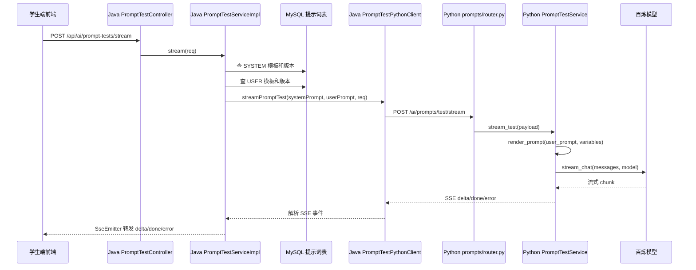
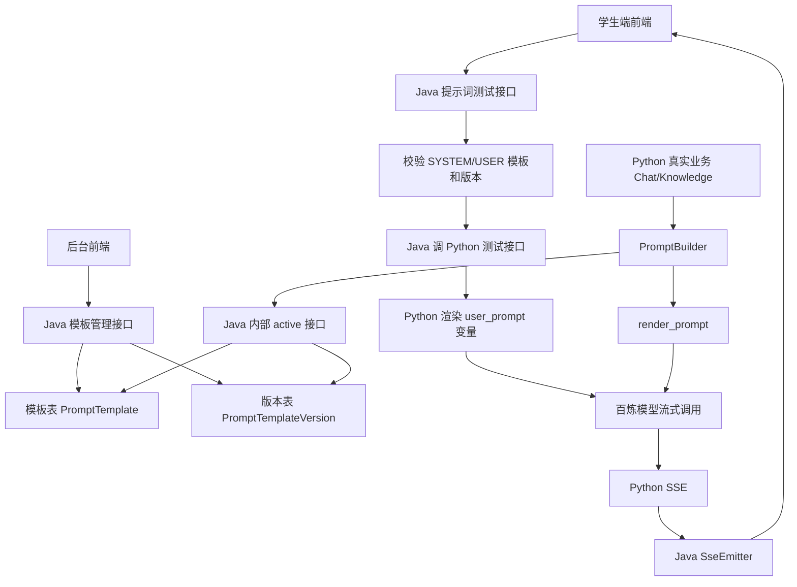

# 提示词模板与提示词测试调用链路梳理

> 梳理日期：2026-08-19  
> 范围：
> - Java 管理端：`D:\YanQue-AI\YanQue-Admin-14\src\main\java\cn\yanque\modules\aiprompt`
> - Python AI 端：`D:\YanQue-AI\YanQue-AI-14\src\yanque_ai`

## 1. 这次功能到底做了什么

这次新增的核心可以分成两块：

1. **提示词模板管理**
   - Java 端负责模板元信息、版本正文、发布、回滚、状态切换。
   - 后台前端负责启用提示词版本，实际动作是把模板的 `activeVersionId` 切到目标版本。
   - 模板表保存稳定业务编码、名称、Agent、类型、场景、状态、当前启用版本 ID。
   - 版本表保存真正的提示词内容、变量说明、版本号、变更说明、创建人。

2. **提示词测试**
   - 学生端选择一个 SYSTEM 模板版本和一个 USER 模板版本进行测试。
   - Java 端校验模板类型和版本归属。
   - Java 把两段提示词正文、变量和模型名发给 Python。
   - Python 渲染 USER 提示词变量，调用百炼模型流式输出。
   - Python 返回 SSE，Java 再原样转发给学生端。

可以把它理解成：

```text
管理后台负责“管提示词、选版本、发起测试”
Python AI 服务负责“把提示词变成 messages，然后真正调模型”
```

## 2. 总体模块地图

### Java 端模块

| 层 | 主要文件 | 作用 |
|---|---|---|
| Controller | `PromptTemplateController` | 模板元信息增删改查、状态切换、下拉选项 |
| Controller | `PromptTemplateVersionController` | 版本列表、详情、新建、发布、回滚 |
| Controller | `PromptTestController` | 发起提示词流式测试 |
| Controller | `InternalPromptController` | 给 Python 内部读取当前启用提示词 |
| Service | `PromptTemplateServiceImpl` | 模板业务校验、分页、创建、更新、状态 |
| Service | `PromptTemplateVersionServiceImpl` | 版本号递增、变量 JSON 校验、发布、回滚 |
| Service | `PromptTestServiceImpl` | 测试前校验 SYSTEM/USER 版本，并转发 SSE |
| Service | `InternalPromptServiceImpl` | 按 code 找 ACTIVE 模板和当前启用版本 |
| Client | `PromptTestPythonClient` | Java 调 Python `/ai/prompts/test/stream` |
| Mapper | `PromptTemplateMapper` | 模板表读写 |
| Mapper | `PromptTemplateVersionMapper` | 版本表读写 |

### Python 端模块

| 层 | 主要文件 | 作用 |
|---|---|---|
| FastAPI 入口 | `main.py` | 启动服务，端口 8000 |
| 应用组装 | `common/application.py` | 注册 health、chat、knowledge、prompts 路由 |
| 提示词测试路由 | `modules/prompts/router.py` | 暴露 `/ai/prompts/test/stream` |
| 提示词测试服务 | `modules/prompts/service.py` | 组装 system/user messages 并流式调模型 |
| Java 提示词客户端 | `integrations/java/prompt_client.py` | Python 反向调用 Java 内部接口读取当前启用提示词 |
| 通用提示词组装 | `prompts/builder.py` | 真实业务中统一读取、渲染、组装 messages |
| 变量渲染 | `prompts/renderer.py` | 用 `{变量名}` 做简单替换 |
| 提示词编码 | `prompts/codes.py` | 定义运行时用到的模板 code 常量 |
| 百炼客户端 | `integrations/bailian/client.py` | 调百炼 chat completions、summary、rerank |

## 3. 数据模型怎么设计

### 3.1 模板表：`PromptTemplateEntity`

模板保存“这个提示词是谁、用在哪里、当前启用哪个版本”。

核心字段：

| 字段 | 含义 |
|---|---|
| `id` | 模板 ID |
| `code` | 稳定业务编码，创建后不允许修改，Python 运行时按它读取提示词 |
| `name` | 模板名称 |
| `agentCode` | 所属 Agent 编码 |
| `promptType` | 提示词类型：`SYSTEM` 或 `USER` |
| `sceneCode` | 使用场景，如 `CHAT`、`RAG`、`SUMMARY`、`JUDGE`、`STRUCTURED_EXTRACT` |
| `status` | 模板状态：`ACTIVE` 或 `INACTIVE` |
| `activeVersionId` | 当前启用版本 ID |
| `description` | 描述 |

### 3.2 版本表：`PromptTemplateVersionEntity`

版本保存真正的提示词正文。

核心字段：

| 字段 | 含义 |
|---|---|
| `id` | 版本 ID |
| `templateId` | 所属模板 ID |
| `versionNo` | 模板内递增版本号 |
| `content` | 提示词正文 |
| `variables` | 变量说明 JSON 字符串 |
| `changeNote` | 本次修改说明 |
| `createBy` | 创建人 |

一个模板可以有多个版本，但只有模板表上的 `activeVersionId` 指向的版本会被运行时使用。

## 4. 模板管理调用链

### 4.1 分页查询模板

入口：

```text
GET /api/ai/prompt-templates
```

调用链：

```text
PromptTemplateController.page
  -> PromptTemplateServiceImpl.page
    -> normalizeStatus / normalizeCode
    -> PromptTemplateMapper.selectPage
    -> selectActiveVersions
      -> PromptTemplateVersionMapper.selectByIds
    -> toRes
```

这条链路做的事：

1. 读取关键词、Agent、状态、分页参数。
2. 状态统一转大写，Agent code 统一转小写。
3. 分页查模板列表。
4. 批量查这些模板当前启用版本，补出 `activeVersionNo`。
5. 返回给前端展示。

### 4.2 新建模板

入口：

```text
POST /api/ai/prompt-templates
```

调用链：

```text
PromptTemplateController.create
  -> PromptTemplateServiceImpl.create
    -> buildCreateEntity
      -> normalizeCode
      -> normalizePromptType
      -> normalizeSceneCode
      -> normalizeStatus
    -> validateUniqueCode
      -> PromptTemplateMapper.selectByCode
    -> PromptTemplateMapper.insert
```

关键规则：

- `code` 和 `agentCode` 会统一转小写。
- `promptType` 只能是 `SYSTEM` 或 `USER`。
- `sceneCode` 只能是固定枚举。
- `status` 默认是 `ACTIVE`。
- `code` 创建后作为稳定业务标识，不允许修改。

### 4.3 编辑模板

入口：

```text
PUT /api/ai/prompt-templates/{id}
```

调用链：

```text
PromptTemplateController.update
  -> PromptTemplateServiceImpl.update
    -> require
      -> PromptTemplateMapper.selectById
    -> normalize fields
    -> PromptTemplateMapper.updateById
```

注意：编辑模板只改基础信息，不改 `code`，也不改当前启用版本。

### 4.4 启用或禁用模板

入口：

```text
PUT /api/ai/prompt-templates/{id}/status
```

调用链：

```text
PromptTemplateController.updateStatus
  -> PromptTemplateServiceImpl.updateStatus
    -> require
    -> normalizeStatus
    -> PromptTemplateMapper.updateStatus
```

运行时内部查询只会读取 `ACTIVE` 模板，所以禁用后 Python 按 code 查询会失败。

## 5. 版本管理调用链

### 5.1 查询版本列表

入口：

```text
GET /api/ai/prompt-templates/{templateId}/versions
```

调用链：

```text
PromptTemplateVersionController.list
  -> PromptTemplateVersionServiceImpl.list
    -> requireTemplate
    -> findActiveVersion
    -> PromptTemplateVersionMapper.selectByTemplateId
    -> toRes
      -> resolveVersionStatus
      -> resolveUserName
```

版本状态规则：

| 状态 | 条件 | 展示文案 |
|---|---|---|
| `CURRENT` | 当前版本 ID 等于模板的 `activeVersionId` | 当前 |
| `UNPUBLISHED` | 版本号大于当前启用版本号，或者没有当前版本 | 未发布 |
| `HISTORY` | 版本号小于当前启用版本号 | 历史 |

### 5.2 新建版本

入口：

```text
POST /api/ai/prompt-templates/{templateId}/versions
```

调用链：

```text
PromptTemplateVersionController.create
  -> PromptTemplateVersionServiceImpl.create
    -> requireTemplate
    -> buildCreateEntity
      -> content 非空校验
      -> nextVersionNo
        -> PromptTemplateVersionMapper.selectMaxVersionNo
      -> normalizeVariables
        -> JSON.isValid
      -> currentUserId
    -> insertVersion
      -> PromptTemplateVersionMapper.insert
    -> activateFirstVersionIfNeeded
      -> updateActiveVersion
        -> PromptTemplateMapper.updateActiveVersionId
```

关键规则：

- `content` 不能为空。
- `variables` 如果填写，必须是合法 JSON 字符串。
- `versionNo` 自动取当前最大版本号加 1。
- 如果这是第一个版本，并且模板还没有当前启用版本，会自动设为当前版本。

### 5.3 发布版本

入口：

```text
PUT /api/ai/prompt-templates/{templateId}/versions/{versionId}/publish
```

调用链：

```text
PromptTemplateVersionController.publish
  -> PromptTemplateVersionServiceImpl.publish
    -> requireTemplate
    -> requireVersion
    -> updateActiveVersion
      -> PromptTemplateMapper.updateActiveVersionId
```

发布动作不复制正文，也不改版本表状态，只是把模板表的 `activeVersionId` 指向目标版本。

### 5.4 回滚版本

入口：

```text
PUT /api/ai/prompt-templates/{templateId}/versions/{versionId}/rollback
```

调用链：

```text
PromptTemplateVersionController.rollback
  -> PromptTemplateVersionServiceImpl.rollback
    -> requireTemplate
    -> findActiveVersion
    -> requireVersion
    -> 判断目标版本号必须小于当前版本号
    -> updateActiveVersion
```

回滚只允许回到历史版本，不能“回滚”到当前版本或更高版本。

## 6. 提示词测试调用链

这是今天最重要的一条链。

### 6.1 学生端前端到 Java

入口：

```text
POST /api/ai/prompt-tests/stream
Content-Type: application/json
Accept: text/event-stream
```

Java 请求对象：`PromptTestReq`

| 字段 | 含义 |
|---|---|
| `systemTemplateId` | SYSTEM 模板 ID |
| `systemVersionId` | SYSTEM 版本 ID |
| `userTemplateId` | USER 模板 ID |
| `userVersionId` | USER 版本 ID |
| `variables` | 用户提示词变量 |
| `model` | 本次测试模型 |

调用链：

```text
PromptTestController.stream
  -> PromptTestServiceImpl.stream
    -> requireVersion(systemTemplateId, systemVersionId, "SYSTEM")
    -> requireVersion(userTemplateId, userVersionId, "USER")
    -> 校验 model 非空
    -> 创建 SseEmitter
    -> 新线程 streamTest
```

`requireVersion` 做三件事：

1. 根据模板 ID 查模板。
2. 校验模板存在，并且类型必须符合 `SYSTEM` 或 `USER`。
3. 根据版本 ID 查版本，校验版本属于这个模板，且正文不为空。

### 6.2 Java 到 Python

核心文件：

```text
PromptTestPythonClient
```

调用链：

```text
PromptTestServiceImpl.streamTest
  -> PromptTestPythonClient.streamPromptTest
    -> buildRequest
    -> POST {yanque-ai.base-url}/ai/prompts/test/stream
    -> readStream
    -> parseEvent
    -> consumer.accept
  -> sendEvent 转发给前端
```

Java 发给 Python 的请求体会转成 snake_case：

```json
{
  "system_prompt": "系统提示词正文",
  "user_prompt": "用户提示词正文",
  "variables": {
    "question": "用户输入的问题"
  },
  "model": "qwen..."
}
```

Java 侧配置：

```text
yanque-ai.base-url
默认值：http://localhost:8000
```

### 6.3 Python 接收测试请求

入口：

```text
POST /ai/prompts/test/stream
```

调用链：

```text
modules/prompts/router.py
  -> stream_prompt_test
    -> get_prompt_test_service
      -> BailianClient(get_settings())
      -> PromptTestService
    -> StreamingResponse(service.stream_test(payload))
```

请求模型：`PromptTestRequest`

```python
system_prompt: str
user_prompt: str
variables: dict[str, str]
model: str
```

### 6.4 Python 组装 messages 并调模型

核心文件：

```text
modules/prompts/service.py
```

调用链：

```text
PromptTestService.stream_test
  -> messages = [
       {"role": "system", "content": system_prompt.strip()},
       {"role": "user", "content": render_prompt(user_prompt.strip(), variables)}
     ]
  -> BailianClient.stream_chat(messages, model=model.strip())
  -> chunk.done ? done 事件 : delta 事件
```

变量替换逻辑在 `prompts/renderer.py`：

```python
content = template
for key, value in variables.items():
    content = content.replace("{" + key + "}", value)
```

也就是说，模板里写：

```text
请回答这个问题：{question}
```

变量传：

```json
{"question": "什么是提示词模板？"}
```

最终入模内容就是：

```text
请回答这个问题：什么是提示词模板？
```

这里没有使用 Jinja 或正则模板引擎，是刻意做简单替换，避免 JSON 示例中的普通花括号被误处理。

### 6.5 Python SSE 返回格式

Python 统一用 `_sse(event, data)` 拼 SSE：

```text
event: delta
data: {"content": "..."}

event: done
data: {"model": "...", "finish_reason": "...", "truncated": false, "usage": {...}}

event: error
data: {"code": "...", "message": "..."}
```

Java 读取 Python SSE 后，再通过 `SseEmitter` 发给前端：

```text
Python SSE -> Java PromptTestPythonClient.readStream -> Java SseEmitter -> 前端
```

### 6.6 提示词测试完整时序图



## 7. 真实业务如何使用提示词模板

提示词测试链路是“学生端把指定版本正文先交给 Java，再由 Java 转给 Python 测试”。

真实业务链路不一样：Python 不直接拿版本 ID，而是按 `code` 去 Java 查询当前启用版本。

### 7.1 Python 读取 Java 当前启用提示词

核心文件：

```text
integrations/java/prompt_client.py
```

调用链：

```text
JavaPromptClient.get_active_prompt_content(code)
  -> JavaPromptClient.get_active_prompt(code)
    -> GET {YANQUE_ADMIN_BASE_URL}/yq-admin/internal/ai/prompts/active?code=xxx
    -> 校验 ApiResponse.code == 200
    -> 取 data.content
```

Python 侧配置：

```text
YANQUE_ADMIN_BASE_URL
默认值：http://localhost:8080
```

注意 Python 代码里内部接口路径拼的是：

```text
/yq-admin/internal/ai/prompts/active
```

也就是说它默认 Java 服务有 `/yq-admin` 这个上下文路径。

### 7.2 Java 内部接口如何返回当前启用版本

入口：

```text
GET /internal/ai/prompts/active?code=xxx
```

调用链：

```text
InternalPromptController.active
  -> InternalPromptServiceImpl.getActivePrompt
    -> 校验 code 非空
    -> PromptTemplateMapper.selectByCode
    -> 模板必须存在且 status == ACTIVE
    -> activeVersionId 必须存在
    -> PromptTemplateVersionMapper.selectById(activeVersionId)
    -> 版本必须属于该模板，且 content 非空
    -> toRes
```

返回内容包含：

| 字段 | 含义 |
|---|---|
| `code` | 模板编码 |
| `name` | 模板名称 |
| `agentCode` | Agent 编码 |
| `promptType` | SYSTEM 或 USER |
| `sceneCode` | 使用场景 |
| `versionId` | 当前启用版本 ID |
| `versionNo` | 当前启用版本号 |
| `content` | 当前启用提示词正文 |
| `variables` | 变量说明 |
| `updateTime` | 更新时间 |

### 7.3 PromptBuilder 统一组装 messages

核心文件：

```text
prompts/builder.py
```

`PromptBuilder` 的职责是：

1. 根据提示词 code 找 Java 当前启用提示词。
2. 用变量渲染模板。
3. 转成模型需要的 `messages`。
4. 按业务需要插入历史对话。

通用调用链：

```text
业务服务
  -> PromptBuilder.build_messages(prompt_specs, history=...)
    -> JavaPromptClient.get_active_prompt_content(spec.code)
    -> render_prompt(template, spec.variables)
    -> append {"role": spec.role, "content": rendered}
    -> 插入 history
    -> 返回 messages
```

提示词 code 常量在 `prompts/codes.py`：

```text
student_chat_system
student_chat_summary_context
student_chat_rag_user
student_chat_no_rag_user
chat_summary_system
chat_summary_user
knowledge_qa_system
knowledge_qa_user
```

### 7.4 学生聊天链路

核心文件：

```text
modules/chat/service.py
```

调用链：

```text
ChatService.stream_chat
  -> _messages
    -> _recall_qa_context
      -> KnowledgeVectorStore.recall
      -> BailianClient.rerank
    -> PromptBuilder.build_student_chat_messages
      -> student_chat_system
      -> 可选 student_chat_summary_context
      -> 根据 citations 选择：
           有 RAG：student_chat_rag_user
           无 RAG：student_chat_no_rag_user
      -> build_messages
        -> JavaPromptClient 读取当前启用提示词
        -> render_prompt 替换 question/context/summary
  -> BailianClient.stream_chat(messages)
  -> SSE delta/done/error
```

这里的关键点是：学生聊天不是写死提示词，而是运行时从 Java 提示词中心读取当前发布版本。

### 7.5 对话摘要链路

调用链：

```text
ChatService.summarize
  -> PromptBuilder.build_summary_messages
    -> chat_summary_system
    -> chat_summary_user
      variables:
        summary: 旧摘要，没有则为“无”
        messages: 待压缩历史消息文本
  -> BailianClient.summarize
```

### 7.6 知识库问答测试链路

核心文件：

```text
modules/knowledge/service.py
```

调用链：

```text
KnowledgeService.stream_knowledge_base_qa
  -> vector_store.recall
  -> 先返回 citations SSE
  -> _build_qa_messages
    -> PromptBuilder.build_knowledge_qa_messages
      -> knowledge_qa_system
      -> knowledge_qa_user
        variables:
          question
          context
      -> JavaPromptClient 读取当前启用提示词
      -> render_prompt
  -> BailianClient.stream_chat
  -> SSE delta/done/error
```

## 8. 测试链路和真实业务链路的区别

| 对比项 | 提示词测试 | 真实业务调用 |
|---|---|---|
| 谁决定版本 | 学生端选择 `systemVersionId` 和 `userVersionId` | Java 模板表的 `activeVersionId` |
| Python 怎么拿提示词 | Java 直接把正文传给 Python | Python 按 code 调 Java 内部接口读取 |
| 是否需要发布 | 不一定，可以测试任意合法版本 | 必须发布成当前启用版本 |
| 变量替换位置 | Python `modules/prompts/service.py` | Python `PromptBuilder` |
| 返回方式 | Python SSE -> Java SSE -> 前端 | 业务自己的 SSE 或普通响应 |

一句话记忆：

```text
测试链路测的是“指定版本”，真实业务用的是“当前发布版本”。
```

## 9. 百炼模型调用链

核心文件：

```text
integrations/bailian/client.py
```

流式调用：

```text
BailianClient.stream_chat(messages, model?)
  -> _build_request
    -> model
    -> messages
    -> temperature
    -> stream = True
    -> stream_options.include_usage = True
    -> max_tokens 可选
  -> OpenAI.chat.completions.create
  -> 遍历 stream chunks
    -> 有 delta.content 就 yield StreamChunk(delta=...)
    -> 最后 yield StreamChunk(done=True, finish_reason=..., usage=...)
```

异常会被翻译成项目内错误：

| 上游异常 | 项目错误 |
|---|---|
| 超时 | `UpstreamTimeoutError` |
| 限流 | `UpstreamRateLimitError` |
| 认证或权限 | `UpstreamAuthError` |
| API 状态错误 | `UpstreamCallError` |
| 连接失败 | `UpstreamCallError` |

## 10. 一张总图



## 11. 今天看代码时建议重点记住的点

1. **模板和版本是分开的**
   - 模板是稳定身份。
   - 版本才是正文。
   - 发布只是切换模板的 `activeVersionId`。

2. **提示词测试不是直接调模型**
   - 前端先进 Java。
   - Java 校验模板和版本。
   - Java 调 Python。
   - Python 调百炼。
   - SSE 再一路返回。

3. **运行时按 code 读取提示词**
   - Python 业务代码不应该写死正文。
   - 它通过 `JavaPromptClient` 按 code 找 Java 当前启用版本。

4. **变量替换很简单**
   - 只做 `{key}` 到 `value` 的字符串替换。
   - 模板变量名要和传入 variables 的 key 对齐。

5. **SYSTEM 和 USER 的角色分工**
   - 测试时 Java 强校验 SYSTEM 模板只能放在 system prompt。
   - USER 模板只能放在 user prompt。

6. **AI Key 只在 Python 端**
   - Java 不直接持有百炼 Key。
   - Java 只把业务请求转发给 Python AI 服务。

## 12. 阅读代码时发现的注意点

### 12.1 `PromptTemplateServiceImpl.detail` 疑似取当前版本 ID 写错

当前代码片段逻辑是：

```java
PromptTemplateEntity promptTemplateEntity = require(id);
PromptTemplateVersionEntity promptTemplateVersionEntity = versionMapper.selectById(promptTemplateEntity.getId());
return toRes(require(id), Collections.singletonList(promptTemplateVersionEntity));
```

这里 `versionMapper.selectById(promptTemplateEntity.getId())` 使用的是模板 ID，不是 `activeVersionId`。

更符合上下文的逻辑应该是读取：

```text
promptTemplateEntity.getActiveVersionId()
```

否则当模板 ID 和版本 ID 不一致时，详情里的 `activeVersionNo` 可能展示不出来或展示错误。

### 12.2 Java 内部接口注释提到“不走 JWT、权限和验签”

`InternalPromptController` 注释里写了：

```text
路径以 /internal 开头，只供服务间调用，不走 JWT、权限和验签。
```

这类接口需要依赖网络隔离、网关规则或内网访问控制，避免被外部直接访问。

## 13. 最短复述版

这套提示词功能可以这样讲：

```text
Java 端做提示词中心，模板表保存稳定 code 和当前启用版本，版本表保存每次提示词正文。
后台可以新建模板、新建版本、发布版本、回滚版本。
提示词测试时，学生端选择 SYSTEM 和 USER 的具体版本，Java 先校验模板类型和版本归属，再把两段正文、变量和模型名发给 Python，最后把 AI 结果返回给学生端。
Python 用 render_prompt 替换 USER 提示词里的变量，组装 system/user messages，然后调用百炼流式接口。
百炼返回 delta/done/error 后，Python 用 SSE 返回给 Java，Java 再用 SseEmitter 转发给前端。
真实业务不是传版本 ID，而是 Python 的 PromptBuilder 按 code 调 Java 内部接口读取当前启用版本，再渲染变量并组装 messages。
所以测试链路测的是指定版本，真实业务用的是当前发布版本。
```
