# 企业 MCP Server 项目总结与流程图

## 1. 先理解 MCP 和工具化能力

MCP（Model Context Protocol）可以理解成 AI Agent 调用外部能力的一套标准协议。大模型本身只会生成文本，不能天然访问公司内部系统；如果希望它去查订单、读文档、查数据库、调用业务接口，就需要把这些外部能力以标准方式暴露给它。

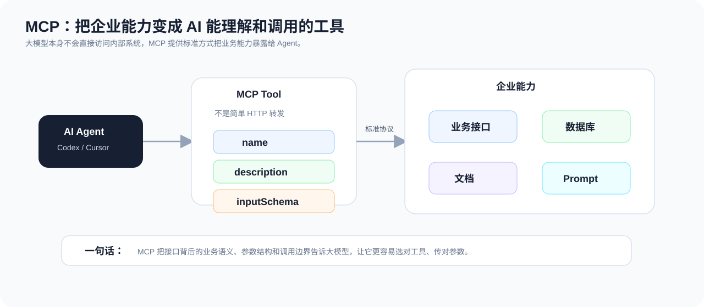

在 MCP 里，最核心的是 Tool。Tool 不是普通后端接口的简单转发，而是面向 AI 重新包装后的“可调用业务能力”。一个 Tool 通常包含三部分：

- `name`：工具名，让模型知道调用哪个能力。
- `description`：工具描述，让模型判断什么时候该用它。
- `inputSchema`：参数结构，让模型知道应该传哪些参数、参数类型是什么。

也就是说，传统 HTTP API 主要是给程序员和系统调用的，而 MCP Tool 是给大模型理解和选择的。它会把接口背后的业务语义、参数约束和调用方式描述清楚，让模型更容易选对工具、传对参数、拿到可用结果。

除了 Tool，MCP 里还有几类常用能力：

| MCP 能力 | 可以理解成 | 在企业里的用途 |
| --- | --- | --- |
| Tool | AI 可以执行的业务动作 | 查订单、查学员、调业务接口、查数据库、触发流程 |
| Prompt | 可复用的提示词模板 | 固定分析口径、客服话术、SQL 生成模板、报告模板 |
| Resource | AI 可读取的知识资源 | 业务文档、指标口径、制度说明、知识库内容 |
| Skill | 可安装/复用的 Agent 能力包 | 把一组工具、提示词和说明打包给 Agent 使用 |

所以 MCP 的价值，不只是“让 AI 调接口”，而是把企业内部能力变成 AI 能发现、能理解、能安全调用、能被治理和审计的标准工具资产。

## 2. 公司背景与为什么需要 MCP 中台

公司现在进入 AI Agent 落地阶段，目标不是只做一个能聊天的助手，而是希望 AI 能真正参与研发提效、业务查询、数据分析、问题排障和流程自动化。像 Codex、Cursor、Claude Code 或公司自研 Agent，本身已经具备很强的推理、规划和代码/任务执行能力，但它们要真正帮公司做事，必须能安全访问企业内部的接口、数据库、文档和业务系统。

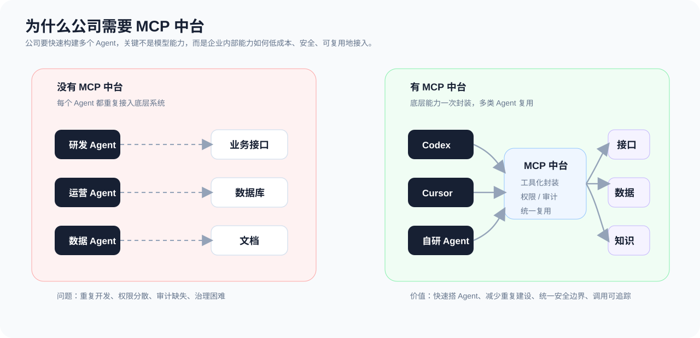

如果没有统一的 MCP 中台，每做一个 Agent 或一个 AI 助手，都要重复开发一遍企业能力接入：

- 每个 Agent 都要单独对接业务接口、数据库和文档系统。
- 每个接口都要重新解释业务语义、参数结构、鉴权方式和返回格式。
- 权限、Token、审计、限流、数据源访问边界都容易分散在不同项目里。
- 新增一个业务能力通常要改 Agent 代码、改后端适配层、重新测试和发布。
- Agent 越多，重复建设越多，后期治理和安全风险也越大。

这个项目的作用，就是把公司已有的接口、数据源、文档和 Prompt 统一沉淀成 MCP 标准能力。业务能力一旦在中台里配置成 Tool、Prompt、Resource 或 Skill，就可以被 Codex、Cursor、Claude、自研 Agent 等不同客户端复用。Agent 不需要关心底层接口怎么鉴权、URL 怎么拼、SQL 怎么查，只需要通过 `tools/list` 发现可用能力，再通过 `tools/call` 安全调用。

所以它对公司的价值不是“多写了一层网关”，而是建设一个企业 AI 能力中台：

> 把分散的业务接口和数据资产统一工具化、权限化、可审计化，让公司后续构建各类 Agent 时不用重复接入底层系统，而是直接复用已经治理好的企业能力，从而显著降低开发成本、提升接入速度，并保证安全边界和调用可追踪。

典型落地效果是：公司要快速搭建一个研发排障 Agent、业务数据查询 Agent、运营助手或内部知识助手时，不需要从零写一堆接口适配代码，而是直接选择已有 MCP 工具组合，再结合 Codex 等 Agent 的规划和执行能力，就能更快形成可用的 AI 应用。

## 3. 项目一句话

这是一个面向企业 AI 场景的 MCP Server 项目，它在原有业务接口和数据源基础上做工具化封装与治理，把传统接口调用升级为大模型更容易理解、选择和执行的 MCP Tools、Prompts、Resources 和 Skills，让 AI 能以更低接入成本、更高调用准确率完成数据读取、业务操作和流程自动化。

它的核心价值可以浓缩成一句话：

> 为公司提供一个统一、可治理、可审计的 AI 能力接入层，把分散的业务接口、数据库和知识资源沉淀成可复用的企业工具资产，让 AI 助手能更快、更准、更安全地参与查询、分析、排障和业务操作。

## 4. 整体架构

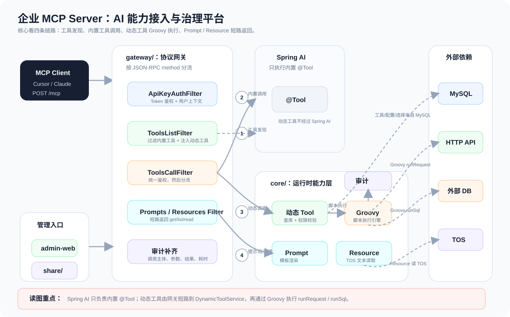

## 5. Spring AI MCP 原生能力

在这个项目里，Spring AI MCP Server 是底层协议基础。它解决的是“如何把一个 Spring Boot 应用变成标准 MCP Server”的问题，让项目不用从零实现 MCP 协议细节。

Spring AI MCP 原生提供的能力主要包括：

| 能力 | 说明 | 在项目中的作用 |
| --- | --- | --- |
| 自动注册 MCP 端点 | 根据配置自动暴露 `POST /mcp` | 项目不需要自己写 `/mcp` Controller |
| Streamable HTTP 协议支持 | 处理 MCP over HTTP 的请求和响应格式 | 兼容 Cursor、Claude、Codex 等 MCP Client |
| `initialize` 处理 | 完成 MCP 握手，返回服务端基础能力 | 客户端先通过它确认服务端能力 |
| `@Tool` 扫描注册 | 启动时扫描 Spring Bean 里的 `@Tool` 方法 | 内置工具可以直接变成 MCP Tool |
| `tools/list` 生成 | 根据已注册的 `@Tool` 生成工具列表 | 提供内置工具的 name、description、inputSchema |
| `tools/call` 执行 | 根据工具名调用对应 Java 方法 | 内置工具调用交给 Spring AI 执行 |

所以 Spring AI MCP 的价值是很明确的：它帮项目完成了 MCP 标准协议和内置工具注册执行，让我们不用自己处理协议握手、基础报文格式、`@Tool` 方法反射调用这些底层工作。

但企业场景里只靠 Spring AI 原生能力还不够。因为 Spring AI 默认更适合“代码里写好的固定工具”：工具在启动时通过 `@Tool` 扫描出来，运行时基本是固定集合。而企业 MCP 中台还需要这些能力：

- 工具来自数据库配置，不一定是 Java 代码里的 `@Tool`。
- 不同用户、不同 Token 看到的工具列表不一样。
- 动态工具要通过 Groovy 脚本执行，并且能调用白名单 API 和数据源。
- Prompt、Resource、Skill 也要做成可配置资产。
- 所有调用要统一鉴权、审计和治理。

因此本项目不是替代 Spring AI，而是在 Spring AI MCP 的协议基础上做企业级增强：Spring AI 负责标准 MCP 协议和内置工具执行，项目自己的网关 Filter 负责动态能力、权限过滤、短路执行和审计治理。

## 6. 为什么用 Filter 扩展 MCP

这一层设计要解决的核心矛盾是：Spring AI MCP 原生能力偏“启动期固定工具”，而企业 MCP 中台需要“运行期可配置、可管控、可审计的动态能力”。

Spring AI 会自动注册 `/mcp`，并在应用启动时扫描 `@Tool` 方法。这个机制很适合内置工具，比如系统工具、计算器工具、固定管理工具。但企业场景里，很多能力不是写死在 Java 代码里的，而是来自后台配置：动态 Tool 来自数据库，Prompt 模板来自数据库，Resource 内容来自对象存储，用户能看到什么还要根据角色和 Token 动态计算。

如果只依赖 Spring AI 原生流程，会遇到几个问题：

- `tools/list` 默认只能列出启动时扫描到的内置 `@Tool`，无法自然包含数据库动态工具。
- `tools/call` 默认只会找对应的 Java 方法，动态工具没有 Java 方法可调用。
- Prompt、Resource 如果没有在 `initialize` 里声明 capability，客户端甚至不会主动请求。
- 企业权限要求不同用户、不同 Token 看到不同工具，这不是静态 `@Tool` 列表能直接解决的。
- 调用审计、参数摘要、错误记录、动态工具执行结果，都需要统一沉淀到企业审计表。

可选方案其实有几种：

| 方案 | 问题 |
| --- | --- |
| 自己写 `/mcp` Controller | `/mcp` 已经由 Spring AI MCP Server 接管，自己重写等于绕开框架协议实现 |
| fork Spring AI | 维护成本高，后续升级困难，也容易和标准协议演进脱节 |
| 所有工具都写成 `@Tool` | 新增业务能力要改代码、发版，失去中台动态配置价值 |
| 在协议 Filter 层扩展 | 不破坏 Spring AI，直接在 JSON-RPC 报文层补企业能力 |

所以项目选择 Servlet Filter 作为扩展点。原因是 MCP over Streamable HTTP 本质上就是 `POST /mcp` 上的一组 JSON-RPC method。Filter 可以在 Spring AI 处理前后读取 method，并根据不同 method 做三种动作：

1. **放行**：内置工具调用继续交给 Spring AI 执行，项目只补鉴权和审计。
2. **改写**：比如 `tools/list`，先让 Spring AI 生成内置工具列表，再过滤并注入动态工具。
3. **短路**：比如动态 `tools/call`、`prompts/list`、`resources/read`，由项目自己查库、执行脚本或读取资源，然后直接返回 MCP JSON-RPC 响应。

这样做的好处是：Spring AI 仍然负责标准 MCP 协议和内置工具执行，项目自己只在协议网关层补企业需要的动态工具、权限控制、Prompt/Resource 能力和审计治理。它不是替代 Spring AI，而是在 Spring AI 之上增加企业级中台能力。

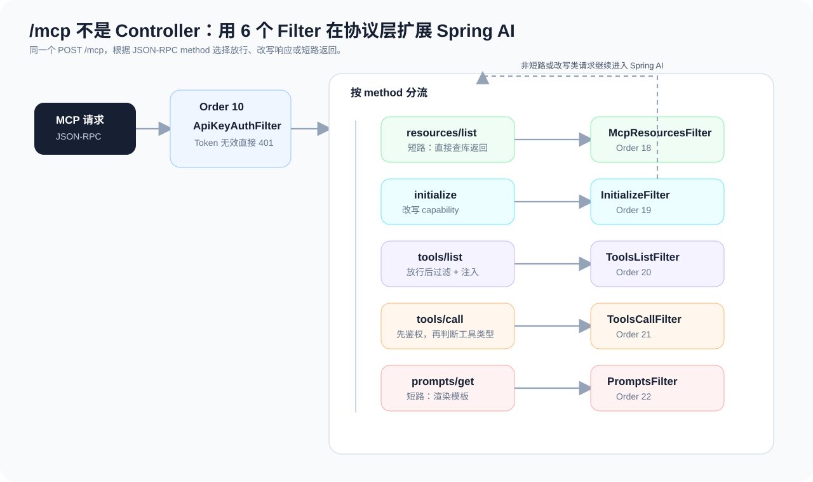

6 个核心 Filter：

| Order | Filter | 主要 method | 策略 |
| --- | --- | --- | --- |
| 10 | `ApiKeyAuthFilter` | `/mcp` 全部请求 | 鉴权，构建 `McpUserContext` |
| 18 | `McpResourcesFilter` | `resources/list`、`resources/read` | 短路，直接返回 Resource 响应 |
|  |                      |                                    |                                             |
| 20 | `McpToolsListFilter` | `tools/list` | 放行 Spring AI 后过滤内置工具并注入动态工具 |
| 21 | `McpToolsCallFilter` | `tools/call` | 统一鉴权；动态工具短路，内置工具放行 |
| 22 | `McpPromptsFilter` | `prompts/list`、`prompts/get` | 短路，直接返回 Prompt 响应 |

这套设计的面试表达重点：

- `/mcp` 被 Spring AI 接管，所以不能靠 Controller 重写。
- MCP over Streamable HTTP 本质是单端点 JSON-RPC，可以按 `method` 分流。
- 动态能力不需要 fork Spring AI，只要在协议层补上 list/call/get/read。
- `initialize` 必须补 `prompts/resources` capability，否则客户端不会主动调用 `prompts/list` 或 `resources/list`。

## 7. Token 鉴权链路

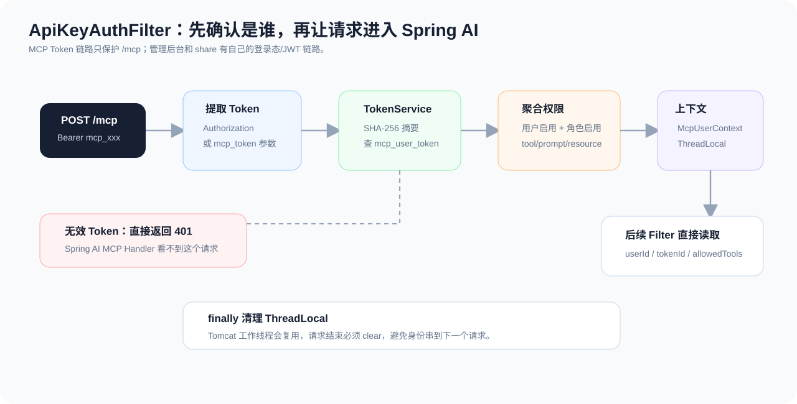

`ApiKeyAuthFilter` 只保护 `/mcp`。它做的事情：

1. 判断请求路径是不是 `/mcp`。
2. 从 `Authorization: Bearer mcp_xxx` 或 `mcp_token` 查询参数取 Token。
3. `TokenService.validate` 对明文 Token 做 SHA-256。
4. 用 Token 摘要查 `mcp_user_token`。
5. 校验 Token 是否启用、是否过期。
6. 校验用户是否启用。
7. 查询用户角色并过滤启用角色。
8. 聚合角色授权的 Tools、Prompts、Resources。
9. 生成或读取 `Mcp-Session-Id`。
10. 写入 `McpUserContextHolder`。
11. 请求结束后在 `finally` 清理 ThreadLocal。

`McpUserContext` 里最关键的信息：

```text
userId
tokenId
userName
roleCodes
allowedTools
allowedPrompts
allowedResources
sessionId
clientIp
```

面试里要强调：Token 鉴权失败时直接返回 `401`，不会进入 Spring AI。这样 Spring AI MCP Handler 永远不会处理未授权请求。

## 8. 两层权限模型

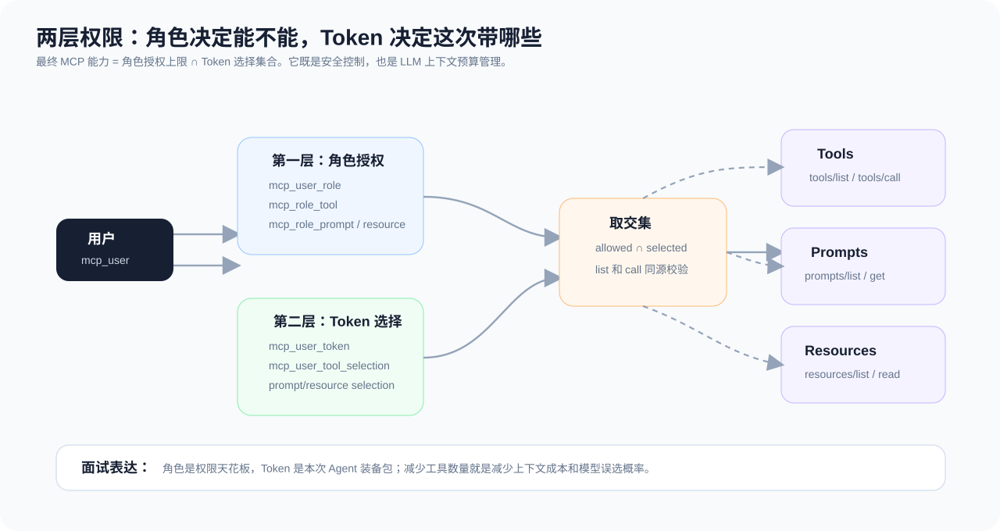

项目的有效能力不是只看角色，也不是只看 Token，而是：

```text
最终能力 = 角色授权上限 ∩ 当前 Token 选择
```

第一层：角色授权，解决“这个用户理论上能不能用”。

```text
mcp_role_tool
mcp_role_prompt
mcp_role_resource
```

第二层：Token 选择，解决“这把 Token 本次加载哪些能力”。它不是再做一遍角色权限，而是给不同 Agent、不同业务场景配置不同的工具包。

```text
mcp_user_tool_selection
mcp_user_prompt_selection
mcp_user_resource_selection
```

为什么 Token 选择不是多余设计？

因为 `tools/list` 返回的工具会进入模型上下文。每个工具不只是一个名字，还包含描述、入参 schema、字段含义和调用约束。工具越多，模型每轮要阅读和比较的候选项就越多，上下文成本会上升，选择错误工具的概率也会上升。

企业内部工具通常还会有大量相似语义，例如订单查询、退款查询、支付查询、用户查询、库存查询、日志查询、指标查询。如果把所有工具都放在一起，模型需要在一堆相近的能力里判断“这次到底该用哪个”，很容易出现两类问题：

1. 该查订单时误选支付工具，导致结果不准。
2. 该读日志时误选业务查询工具，导致排障路径变长。
3. 无关工具太多，占用上下文窗口，让真正相关的工具描述被稀释。

所以这个项目把权限分成两层：

```text
角色 = 这个用户最多能拥有哪些能力
Token = 这个 Agent / 这个场景本次实际加载哪些能力
```

这样同一个用户可以创建多把 Token，每把 Token 面向一个明确场景，只挂载必要工具：

- 数据分析 Token：只加载数据源查询、指标口径、报表类 Prompt。
- 研发排障 Token：只加载日志查询、服务健康检查、故障手册 Resource。
- 运营客服 Token：只加载用户查询、订单查询、售后状态查询。
- 内容创作 Token：只加载文档 Resource、Prompt 模板和素材检索工具。

这样做的价值不只是更安全，而是让 Agent 的工具空间变小、语义更聚焦、选择更稳定。对模型来说，Token 就像“本次任务的工具箱”；对公司来说，Token 是按场景交付 AI 能力的最小治理单元。

典型表达：

> 我们没有把所有企业工具一次性暴露给模型，而是允许每个 Token 选择一组工具。角色负责控制权限上限，Token 负责控制当前 Agent 实际携带的工具包。这样既能减少上下文成本，也能降低模型在相似工具之间选错的概率。

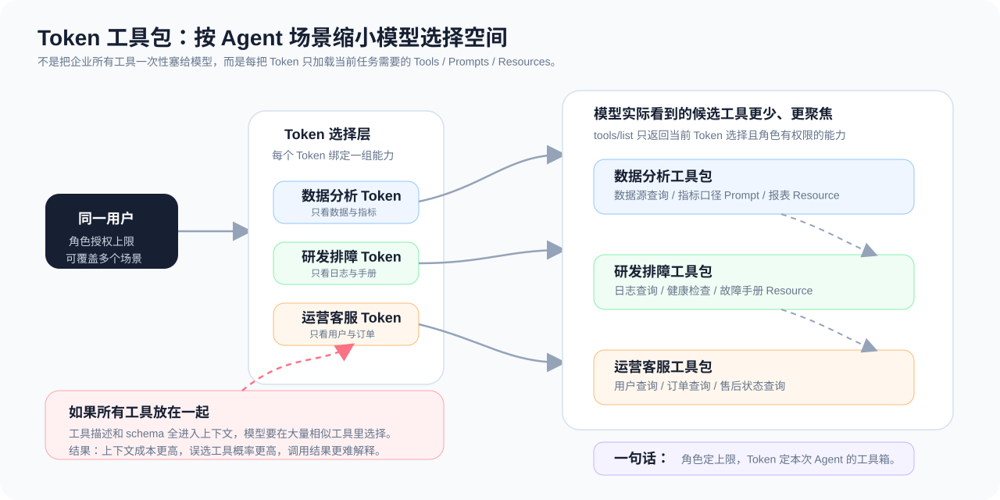

## 9. 一般 Agent 调用 MCP 的顺序

Agent 调用 MCP Server 通常不是一上来就直接执行工具，而是先完成“握手、发现、选择、调用”这几个步骤。

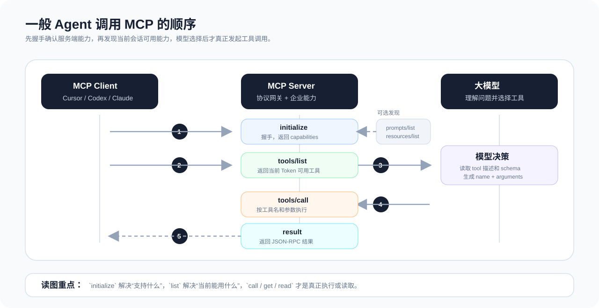

1. `initialize`：客户端先和 MCP Server 握手，确认服务端支持哪些能力，比如 Tools、Prompts、Resources。
2. `tools/list`：客户端拉取当前会话可用的工具列表，工具名、描述和 `inputSchema` 会进入模型上下文。
3. 模型选择工具：大模型根据用户问题和工具描述，判断是否需要调用工具，以及应该传什么参数。
4. `tools/call`：客户端把模型选出的工具名和参数发给 MCP Server 执行。
5. 返回结果：MCP Server 把工具执行结果返回给客户端，客户端再交给模型整理成自然语言答案或继续下一步调用。

Prompt 和 Resource 也是类似逻辑：先通过 `prompts/list`、`resources/list` 发现可用能力，再通过 `prompts/get`、`resources/read` 获取具体内容。

所以后面讲到的 `initialize` capability 改写、`tools/list` 注入动态工具、`tools/call` 统一鉴权和分流，本质上都是在这条标准调用链路上做企业级增强。

## 10. `tools/list` 工具发现链路

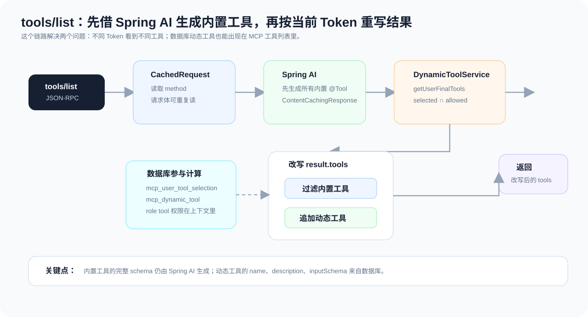

`tools/list` 的实现不是简单追加动态工具，而是严格分步骤：

1. `McpToolsListFilter` 先缓存请求体，判断 method 是否为 `tools/list`。
2. 是 `tools/list` 时，用 `ContentCachingResponseWrapper` 包住响应。
3. 放行给 Spring AI，让它生成原始内置 `@Tool` 列表。
4. 从 `McpUserContext` 取 `userId/tokenId/allowedTools`。
5. `DynamicToolService.getUserFinalTools` 查询当前 Token 选择的工具。
6. 用 `selected ∩ allowed` 得到最终工具集合。
7. 内置工具：从 Spring AI 原始 tools 里保留被选择且有权限的。
8. 动态工具：从 `mcp_dynamic_tool` 读取 `tool_name/tool_description/input_schema`，组装成 MCP Tool。
9. 替换 `result.tools`。
10. 保持原响应格式，普通 JSON 仍返回 JSON，SSE `data:` 响应仍包装成 SSE。

这一段最适合回答“动态工具为什么能出现在 MCP 客户端里”：

> Spring AI 原本只知道 `@Tool`，不知道数据库工具。我们让 Spring AI 先生成内置列表，然后在 `tools/list` 响应里把内置工具过滤掉不该看的，再把数据库动态工具按 MCP schema 注入进去。

## 11. `tools/call` 调用链路

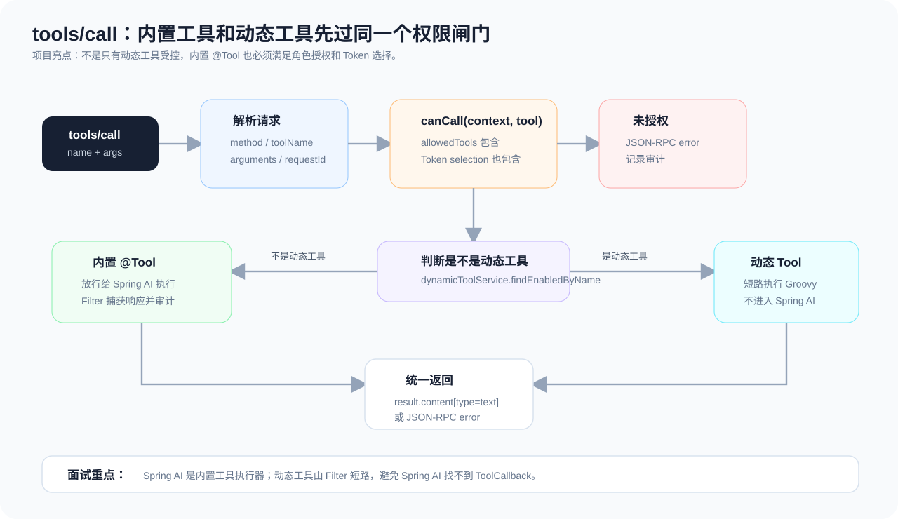

`McpToolsCallFilter` 是项目的核心亮点之一，因为它让内置工具和动态工具都走同一个调用闸门：

```java
canCall(context, toolName)
```

等价于：

```text
context != null
allowedTools 包含 toolName
当前 token selection 包含 toolName
```

调用分支：

| 分支 | 处理方式 |
| --- | --- |
| 未授权 | 返回 JSON-RPC error，并记录审计 |
| 内置工具 | 放行给 Spring AI 执行；Filter 捕获响应并记录审计 |
| 动态工具 | 不再进入 Spring AI，直接调用 `DynamicToolService.execute` 执行 Groovy |

面试表达：

> 这里没有“内置工具因为是 Java 代码所以绕过权限”的漏洞。所有 `tools/call` 都先经过同一个 `canCall()`，只是通过权限后，内置工具交给 Spring AI，动态工具由 Bear 自己短路执行。

## 12. 动态工具与 Groovy 执行

先理解 Groovy 是什么：

Groovy 是一种运行在 JVM 上的动态脚本语言，可以直接调用 Java 对象和方法。它和 Java 在同一个运行环境里，可以复用项目里已有的服务对象、执行器和安全控制，也不需要把每个工具逻辑都写成固定的 Java 类。对这个项目来说，Groovy 的定位不是“写后端主业务”，而是作为动态工具的运行时脚本引擎。

也就是说，Java 负责稳定的底座：MCP 协议、Token 鉴权、权限校验、审计、API 白名单、数据源白名单、脚本安全和超时控制；Groovy 负责每个动态工具自己的轻量编排逻辑：读取模型传来的参数，调用被授权的 API 或数据源，整理结果，再返回给 Agent。

为什么动态工具要用 Groovy？

如果没有 Groovy，动态工具很容易退化成“一个工具对应一个 API”的映射关系。比如一个工具查订单接口，一个工具查支付接口，一个工具查物流接口。这样虽然也能让 Agent 调接口，但工具粒度会越来越碎，模型需要在更多工具里选择，而且很多业务问题并不是单个接口能直接回答的。

比如用户问“帮我看一下这个订单现在为什么还没有完成”，背后可能需要先查订单状态，再查支付状态，再查物流状态，必要时还要查售后记录或数据源里的补充信息。如果没有脚本编排层，就只能把这些能力拆成多个工具，让模型自己连续调用多个工具、自己拼结果。这样不仅上下文更长，调用次数更多，也更容易在中间步骤选错工具或漏掉关键接口。

如果完全不用 Groovy，每新增一个稍微复杂的企业能力，通常就要走这样的流程：

1. 后端新写一个 Java `@Tool` 方法。
2. 写接口适配、参数转换、返回结果整理。
3. 加权限、加审计、加异常处理。
4. 重新编译、测试、发布服务。
5. Agent 重新发现这个工具后才能使用。

这对企业 Agent 落地不够快。因为公司内部能力很多，业务查询、数据分析、运维排障、文档检索、外部 API 编排都可能不断变化。如果每个组合动作都要写 Java 和发版，MCP 中台就会变成“另一个需要排期的后端项目”，不能真正支撑快速试错和快速交付。

有了 Groovy 之后，动态工具可以变成“配置 + 脚本”的运行时资产：

1. 工具名、描述、入参 schema 存在数据库里，用来给模型识别和选择。
2. Groovy 脚本存在数据库里，用来描述这个工具具体怎么执行。
3. 脚本可以先处理参数，比如补默认值、做字段转换、校验必填项。
4. 脚本可以通过 `runRequest` 调用多个已绑定的企业 API。
5. 脚本可以通过 `runSql` 查询已绑定的数据源，补充接口拿不到的信息。
6. 脚本可以做分支判断、结果聚合、字段过滤和格式整理。
7. 执行结果统一返回 MCP `tools/call` 响应，并写入审计日志。

所以 Groovy 解决的核心问题不只是“不发版”，还包括“一个工具能不能表达一个完整业务动作”。没有 Groovy，Tool 更像 API 清单；有了 Groovy，Tool 可以把多个 API、数据源查询和处理逻辑编排成一个 workflow，让 Agent 调一个工具就完成一件相对完整的事。

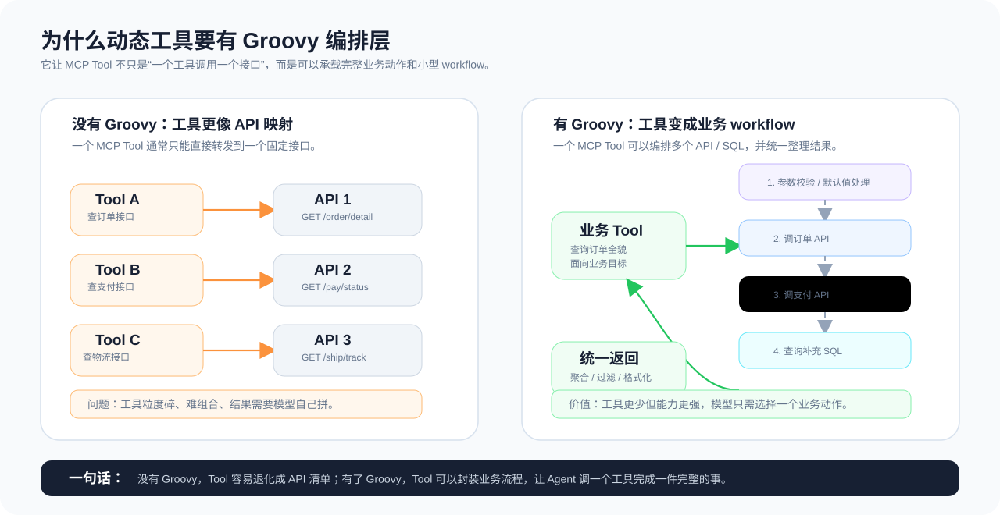

这里要强调一点：项目不是让 Groovy 随便执行任意代码。Groovy 外面包了一层安全壳：它只能拿到项目注入的 `params/userId/userName/toolName/runRequest/runSql`，调用外部系统也必须经过工具绑定的 API 白名单和数据源白名单，并且还有脚本安全检查、编译限制、线程池隔离、超时控制和审计日志。

典型表达：

> Java 负责把 MCP 中台做稳，Groovy 负责让工具能力变灵活。没有 Groovy，工具容易变成一个个 API 映射，复杂问题要靠模型多次调用和自己拼结果；有了 Groovy，一个工具可以在服务端编排多个 API 和数据源查询，形成面向业务目标的 workflow，同时仍然受到 Token、角色、白名单和审计约束。

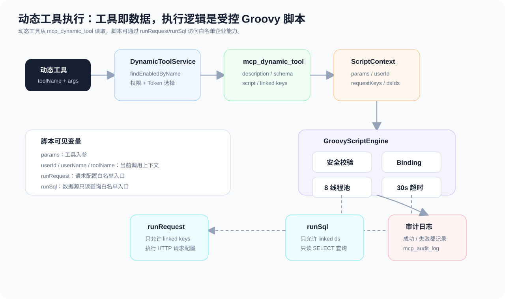

动态工具来自 `mcp_dynamic_tool` 表。核心字段：

| 字段 | 作用 |
| --- | --- |
| `tool_name` | MCP 工具名，`tools/call.params.name` 使用 |
| `tool_description` | 给模型看的描述，影响工具选择 |
| `input_schema` | MCP Tool 入参 schema |
| `groovy_script` | 运行时脚本 |
| `linked_request_keys` | 脚本允许调用的请求配置 key 白名单 |
| `linked_data_source_ids` | 脚本允许查询的数据源 ID 白名单 |
| `enabled` | 是否启用 |
| `publish_status` | 发布状态，创作/社区场景使用 |

动态执行过程：

1. `McpToolsCallFilter` 判断工具是动态工具。
2. `DynamicToolService.execute(toolName, params)`。
3. 查询启用的 `mcp_dynamic_tool`。
4. 校验角色授权和 Token 选择。
5. 解析 `linked_request_keys` 和 `linked_data_source_ids`。
6. 构造 `ScriptContext`。
7. `GroovyScriptEngine.execute`。
8. 执行前字符串安全检查。
9. 使用带 `GroovySecurityCustomizer` 的 `CompilerConfiguration` 编译脚本。
10. 注入 `params/userId/userName/toolName/runRequest/runSql`。
11. 用固定 8 线程池执行脚本。
12. 最多执行 30 秒。
13. 返回 `ScriptResult.success/failure`。
14. `DynamicToolService` 在 `finally` 写入 `mcp_audit_log`。

脚本可见变量：

```text
params
userId
userName
toolName
runRequest
runSql
```

`runRequest` 只能调用 `linked_request_keys` 里的配置：

```groovy
def result = runRequest.runRequest("demo_clock", params)
return result
```

`runSql` 只能查询 `linked_data_source_ids` 里的数据源，并且只允许 SELECT：

```groovy
def rows = runSql.runSql(1L, "select id, name from user limit 10")
return rows
```

## 13. 外部 API 配置执行

很多 MCP Tool 表面上是“查订单、查库存、查用户、查物流、查审批状态”，但底层大部分还是在访问一个个业务 API。这些 API 不一定只来自企业内部系统，也可能来自第三方平台、供应商系统、SaaS 服务、开放平台或其他中台服务。

如果每个动态工具都在 Groovy 里直接写 URL、Header、鉴权方式、参数拼接和超时时间，会有几个问题：

1. 接口信息散落在脚本里，后期接口改地址、改鉴权、改参数时很难统一维护。
2. 每个脚本都能自己拼请求，平台很难控制“这个工具到底允许访问哪些 API”。
3. 相同 API 可能被多个工具重复编写，造成重复配置和不一致。
4. 鉴权信息、Header、签名、超时、限流这些治理能力容易失控。
5. 审计时只能看到工具执行了脚本，不容易追踪它具体访问了哪个外部能力。

所以项目把 API 调用抽成 `mcp_request_config` 配置。它相当于把底层 API 先登记成平台资产，再让动态工具通过 `config_key` 去调用。Groovy 脚本不直接关心完整 URL 和鉴权细节，只调用：

```groovy
runRequest.runRequest("order_detail_api", params)
```

真正的接口地址、请求方法、Header、Body 模板、默认参数、超时、限流、启停状态，都在管理端配置和治理。

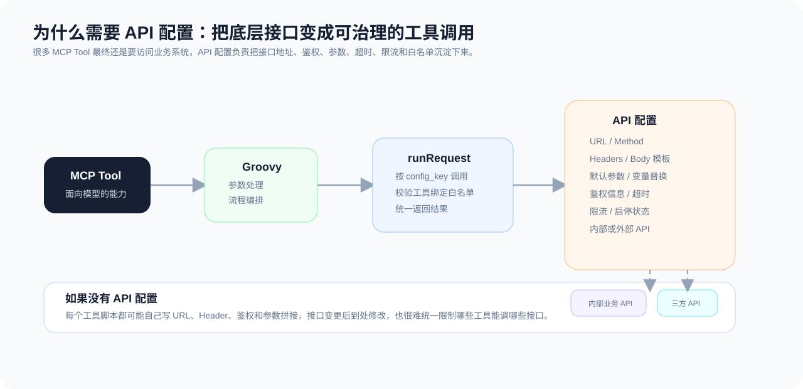

`RequestConfigService` 是动态工具调用 API 的受控入口。它的职责不是简单发 HTTP 请求，而是把“工具脚本想访问外部能力”这件事变成可配置、可授权、可追踪的受控调用。

当前版本真正执行的是 HTTP 类型；SOA/Hessian 字段存在于配置模型里，但运行时如果不是 HTTP 会提示暂未接入对应客户端。这个设计也说明：API 配置层不是只能服务 HTTP，将来可以扩展到更多企业内部 RPC 或三方调用方式。

执行过程：

1. 根据 `config_key` 查询 `mcp_request_config`。
2. 校验配置存在且 `enabled=true`。
3. 合并 `params_default` 和脚本运行时 `params`，运行时参数优先。
4. 单机内存按分钟限流。
5. 只允许 HTTP 类型进入执行。
6. 用 `{{变量名}}` 替换 URL 和 bodyTemplate。
7. 用 OkHttp 按配置 method、headers、body、timeout 发请求。
8. 返回结构保持为：

```json
{
  "status": 200,
  "body": "响应文本"
}
```

这里的设计点：

- 动态脚本不直接拼任意 HTTP 客户端，而是走 `runRequest`。
- `runRequest` 先检查工具关联白名单，再执行请求配置。
- API 的 URL、Header、Body、默认参数、鉴权、超时、限流都由管理端治理。
- API 可以是企业内部业务接口，也可以是外部三方接口，工具只通过配置 key 使用。
- 一个动态工具可以编排多个 API 配置，把多个底层接口包装成一个更符合业务语义的 MCP Tool。

典型表达：

> MCP Tool 面向模型表达的是业务能力，但工具底层大多数时候还是要访问 API。API 配置层的价值，是把内部接口和外部接口先沉淀成受控资产，再让 Groovy 通过 `runRequest` 按 key 调用。这样工具可以灵活编排 API，但不会变成脚本里随便写 URL、随便带鉴权、随便访问外部系统。

## 14. 数据源只读查询

除了调用 API，动态工具也可能需要直接查询数据库。原因很简单：企业里不是所有数据都有现成 API，有些指标、报表、运营明细、排障信息，可能本来就在数据库里；如果为了每个查询都临时开发一个 API，成本会很高，也会拖慢 Agent 能力落地。

比如这些场景就很典型：

1. 数据分析 Agent 要查某个时间段的订单量、转化率、退款率。
2. 运营助手要查某个用户最近的订单、售后、支付状态。
3. 研发排障 Agent 要查某个任务、配置或业务记录当前状态。
4. 业务问答工具要把 API 返回结果和数据库里的补充字段合并起来。

所以这个项目允许动态工具通过 `runSql` 查询已授权的数据源。这样 Tool 不一定只能调用 API，也可以在安全边界内直接读取数据库，把数据查询能力包装成 MCP Tool 暴露给 Agent。

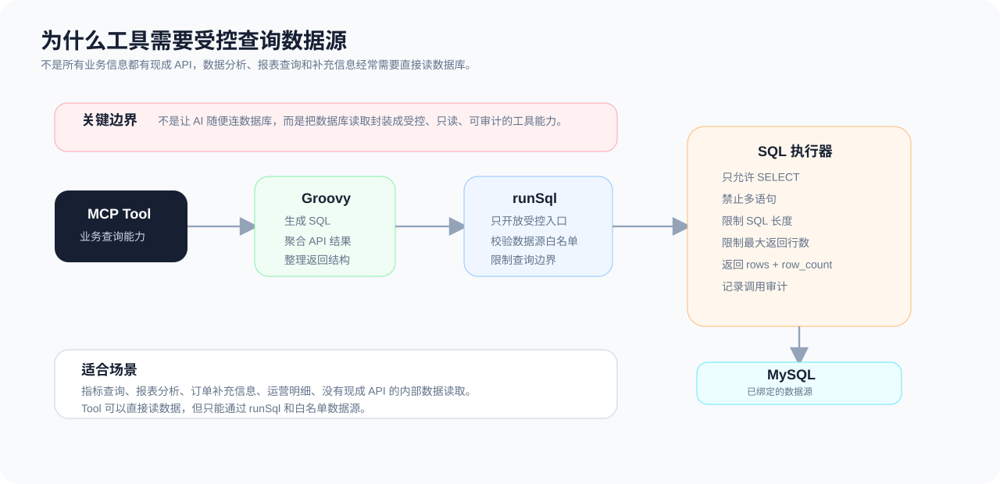

但这里最重要的是“受控”。项目不是让 AI 或脚本随便连数据库、随便执行 SQL，而是把数据库读取封装成一个受限制的执行器。Groovy 脚本只能调用项目注入的 `runSql`，不能绕过平台自己创建连接；`runSql` 还会先检查当前动态工具是否绑定了这个数据源。

项目的外部数据源执行器是 `ExternalDataSourceSqlExecutor`。

限制：

| 限制 | 当前实现 |
| --- | --- |
| SQL 类型 | 只允许 `SELECT` |
| SQL 长度 | 最多 10000 字符 |
| 多语句 | 不允许包含分号 |
| 最大行数 | 最多 500 行 |
| 数据源权限 | 必须在动态工具 `linked_data_source_ids` 里 |
| 结果结构 | `datasource_id`、`row_count`、`max_rows`、`truncated`、`rows` |

这个链路回答的是“AI 能不能随便查数据库”的问题：

> 不能。脚本只能通过 `runSql`，`runSql` 先校验数据源白名单，然后 SQL 执行器只允许单条 SELECT，并且限制最大返回行数。

为什么要这样设计？

- 对业务来说，工具可以直接把数据库里的信息变成 Agent 可调用能力，不必每个查询都新开发 API。
- 对模型来说，一个“查询业务指标”的 Tool 比一堆底层表结构更容易理解和选择。
- 对平台来说，所有数据库访问都经过统一入口，可以做白名单、只读限制、行数限制和审计。
- 对安全来说，动态工具只能访问自己绑定的数据源，不能因为脚本灵活就扩大数据访问范围。

典型表达：

> API 能覆盖标准业务动作，数据源查询能覆盖临时分析、报表和补充数据读取。我们没有让 AI 直接裸连数据库，而是把数据库查询封装成 `runSql`：工具必须先绑定数据源，SQL 只能是单条 SELECT，返回行数也有限制。这样既保留了工具直接查数据的灵活性，又把数据库访问控制在平台治理范围内。

## 15. Prompt、Resource、Skill

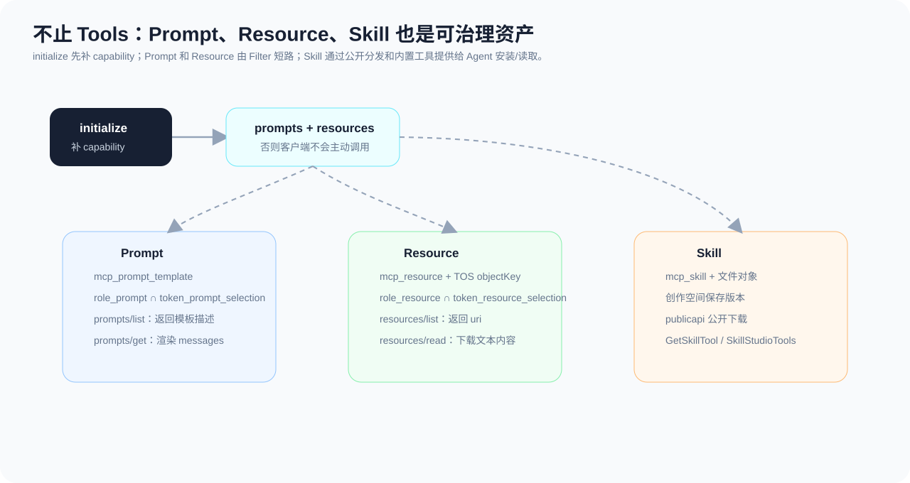

这个项目不是只做 Tools。Tool 解决的是“AI 能执行什么动作”，但企业 Agent 真正落地，还需要解决另外三个问题：

1. AI 做事时依据哪些公司内部资料？
2. 一些稳定的分析步骤、输出格式和业务流程能不能复用？
3. 能不能把一组工具、提示词、文档说明打包成一个可交付的 Agent 能力？

所以项目里还支持 Prompt、Resource、Skill。它们和 Tool 放在一起，构成企业 AI 能力资产：

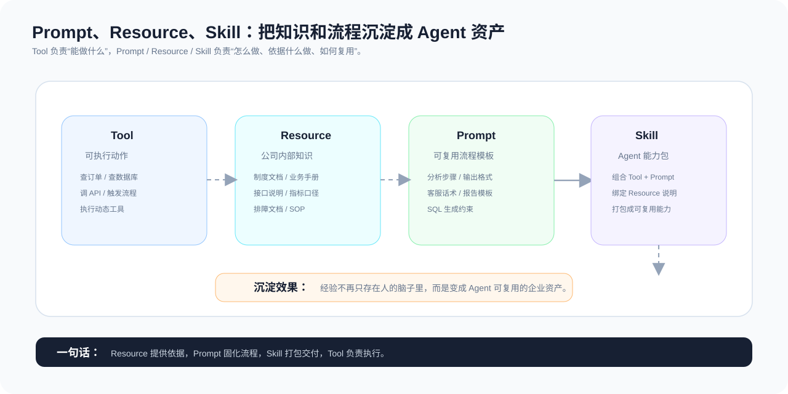

### Prompt

Prompt 可以理解成可复用的提示词模板，核心价值是把“人写给模型的经验流程”沉淀下来。很多时候，真正影响 Agent 效果的不只是工具能不能调用，而是调用前后怎么分析、怎么约束输出、怎么组织步骤、怎么解释结果。

比如公司里可能会沉淀这些 Prompt：

- 数据分析 Prompt：固定分析口径、统计周期、异常判断方式和输出结构。
- 客服回复 Prompt：固定语气、合规话术、问题分类和升级规则。
- SQL 生成 Prompt：限定只读查询、字段解释、表关系和输出格式。
- 排障 Prompt：规定先看哪些现象，再查哪些日志，最后如何给结论。

没有 Prompt 沉淀时，每个 Agent 或每个使用者都要重复写提示词，质量不稳定，也很难统一公司口径。有了 Prompt 之后，常见任务可以复用同一套模板，让模型按公司认可的流程完成分析和输出。

相关类：

```text
McpPromptsFilter
PromptAccessService
PromptTemplateService
```

链路：

1. `initialize` 注入 prompts capability。
2. `prompts/list` 由 `McpPromptsFilter` 短路。
3. `PromptAccessService.listAccessiblePrompts` 做 `allowedPrompts ∩ token prompt selection`。
4. 返回 prompt name、description、arguments、`_meta.linked_tools`。
5. `prompts/get` 查询模板。
6. 校验 `PromptAccessService.canAccess`。
7. 用 arguments 渲染模板内容。
8. 返回 MCP `messages`。
9. 记录审计，工具名形如 `PROMPT:name`。

### Resource

Resource 可以理解成 AI 可以读取的公司内部资源，最典型的就是内部文档。比如制度说明、业务手册、接口文档、指标口径、操作 SOP、排障手册、产品说明、培训资料等。

对企业来说，很多知识原来散落在文档、网盘、对象存储或不同系统里。Agent 如果只会调用 Tool，但拿不到这些背景资料，就容易出现“能查数据，但不知道怎么解释”的问题。Resource 的作用，就是把这些内部知识以 MCP 标准方式暴露给 Agent，让模型在回答或执行任务时有依据。

比如：

- 问“这个指标为什么这么算”，Agent 可以读取指标口径 Resource。
- 问“这个故障应该怎么处理”，Agent 可以读取排障手册 Resource。
- 问“请按公司规范生成回复”，Agent 可以读取制度或话术 Resource。
- 动态工具执行前后，也可以结合 Resource 里的说明解释结果。

所以 Resource 不是普通文件下载，而是把公司知识库变成 Agent 可发现、可读取、可鉴权、可审计的上下文资源。

相关类：

```text
McpResourcesFilter
ResourceAccessService
TosStorageService
```

链路：

1. `initialize` 注入 resources capability。
2. `resources/list` 由 `McpResourcesFilter` 短路。
3. `ResourceAccessService.listAccessibleResources` 做 `allowedResources ∩ token resource selection`。
4. 返回 resource uri、name、description、mimeType。
5. `resources/read` 根据 uri 校验可访问。
6. 通过 `objectKey` 从 TOS 下载文本内容。
7. 返回 MCP `contents`。
8. 记录审计，工具名形如 `RESOURCE:uri`。

### Skill

Skill 更偏“Agent 能力包”。如果说 Tool 是动作，Prompt 是流程模板，Resource 是知识依据，那么 Skill 就是把这些东西组合起来，沉淀成一个可复用、可安装、可分发的能力包。

它解决的是“可复用流程如何交付”的问题。比如一个“订单售后分析 Skill”里，可以包含：

- 需要使用哪些 Tools：订单查询、退款查询、用户查询。
- 推荐使用哪些 Prompts：售后原因分析模板、客服回复模板。
- 依赖哪些 Resources：售后规则、退款政策、订单状态说明。
- Agent 应该按什么步骤执行：先查订单，再查支付，再判断状态，最后生成解释。

这样能力不再只是单个接口、单个提示词或单份文档，而是被组织成一个面向任务的完整包。公司后续要搭建新的 Agent 时，可以直接复用已有 Skill，而不是重新整理工具、文档和提示词。

当前项目里 Skill 主要包括：

- 创作空间保存 Skill。
- TOS 存储 Skill 文件。
- publicapi 提供公开下载。
- `GetSkillTool`、`SkillStudioTools` 提供 MCP 工具侧读取/安装辅助能力。

典型表达：

> Tool 让 Agent 能执行动作，Resource 让 Agent 能读取公司内部知识，Prompt 把稳定流程和输出口径沉淀下来，Skill 再把工具、提示词和文档组合成可复用能力包。这样企业经验不会只停留在个人使用习惯里，而是变成可以被不同 Agent 复用的资产。

## 16. 第三方 MCP Server 统一接入

除了企业内部 API、数据库和文档资源，Bear MCP 还可以把第三方 MCP Server 纳入统一出口。当前项目里已经有飞书远程 MCP 的接入示例：Bear 对外暴露 `feishu_mcp_*` 工具，内部再代理请求飞书官方远程 MCP。

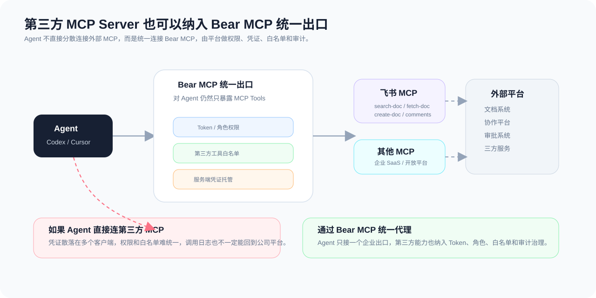

为什么这个能力重要？

如果 Agent 直接连接飞书、SaaS、开放平台或其他第三方 MCP Server，会出现几个问题：

1. 每个 Agent 都要单独配置第三方 MCP 地址和凭证。
2. 第三方访问凭证可能散落在不同客户端或不同 Agent 配置里。
3. 公司很难统一控制某个 Agent 能调用第三方平台的哪些工具。
4. 第三方 MCP 的调用日志不一定能回到公司自己的审计体系。
5. 当第三方工具很多时，模型也会遇到和内部工具一样的选择困难。

所以更适合企业的方式是：不要让 Agent 直接分散连接第三方 MCP，而是让 Agent 只连接 Bear MCP。Bear MCP 作为公司统一出口，再由服务端去代理飞书或其他第三方 MCP Server。

这样做之后，第三方能力也可以进入统一治理：

- **统一入口**：Agent 只需要接 Bear MCP，不需要同时接多个外部 MCP Server。
- **统一凭证**：飞书 App ID、App Secret、tenant access token 等凭证由服务端管理，不暴露给 Agent。
- **统一权限**：第三方 MCP 工具也可以作为 Bear MCP Tool 暴露，再纳入角色和 Token 选择。
- **统一白名单**：比如飞书 MCP 可以用 `allowed_tools` 或 `X-Lark-MCP-Allowed-Tools` 限制本次可调用工具。
- **统一审计**：Agent 调用的是 Bear 暴露的工具，因此调用人、工具名、状态、耗时和错误都可以落到公司审计体系。
- **统一体验**：对 Codex、Cursor、Claude 或自研 Agent 来说，它看到的仍然是一个 MCP Server 和一组工具。

以飞书为例，项目里提供了这些工具：

| Bear MCP Tool | 作用 |
| --- | --- |
| `feishu_mcp_list_tools` | 列出飞书官方远程 MCP 当前可用工具 |
| `feishu_mcp_call_tool` | 通用代理调用飞书 MCP 工具 |
| `feishu_mcp_fetch_doc` | 读取飞书云文档内容 |
| `feishu_mcp_search_doc` | 搜索飞书云文档 |
| `feishu_mcp_create_doc` | 创建飞书云文档 |
| `feishu_mcp_add_comment` | 给飞书云文档添加评论 |

这说明 Bear MCP 不只是企业内部能力的封装层，也可以变成第三方 MCP Server 的企业代理层。外部 MCP 负责连接飞书等平台，Bear MCP 负责把这些外部能力接入公司自己的权限、Token、白名单、审计和工具选择体系。

典型表达：

> 我们不希望每个 Agent 都直接去连飞书或其他第三方 MCP Server，因为那样凭证、权限、工具白名单和审计都会分散。Bear MCP 可以作为统一出口：Agent 只连接 Bear，Bear 在服务端代理第三方 MCP，并把第三方工具也纳入角色权限、Token 工具包和审计日志。这样既能复用外部平台能力，又不会失去企业治理。

## 17. 审计日志

企业 MCP Server 不能只关注“AI 能不能调到工具”，还要关注“调用以后能不能追踪和复盘”。因为 Agent 一旦接入公司内部 API、数据库和文档资源，就会产生真实业务影响：它查了什么、谁让它查的、有没有失败、失败在哪里、一次调用耗时多久，都需要被平台记录下来。

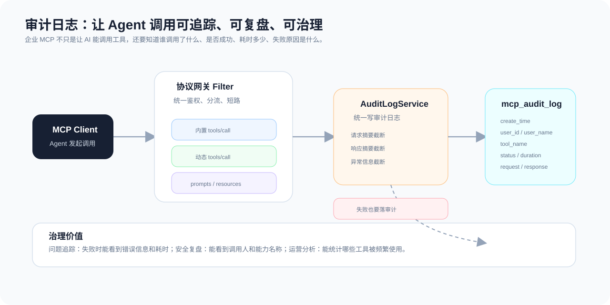

审计日志解决的是三个问题：

1. **安全追踪**：当某个敏感工具被调用时，能看到调用用户和工具名称。
2. **问题排查**：当工具调用失败时，能看到请求摘要、错误信息和耗时。
3. **运营治理**：管理端可以统计最近调用、今日调用量，判断哪些工具被频繁使用，哪些工具经常失败。

这个项目里统一使用 `AuditLogService` 写入 `mcp_audit_log`。当前落库字段包括：

| 字段 | 含义 |
| --- | --- |
| `create_time` | 调用发生时间 |
| `user_id` / `user_name` | 调用主体 |
| `tool_name` | 被调用的能力名称 |
| `request_params` | 请求参数摘要 |
| `response_summary` | 响应内容摘要 |
| `status` | 调用状态，如 `SUCCESS` / `ERROR` |
| `error_message` | 失败原因 |
| `duration_ms` | 调用耗时 |

审计不是只记录动态工具。项目在多个 MCP 能力入口都补了审计：

- `tools/call`：内置工具和动态工具都会记录。
- 动态工具：`DynamicToolService` 在脚本执行完成或失败后记录。
- Prompt：`prompts/list`、`prompts/get` 会按 `PROMPT:name` 记录。
- Resource：`resources/list`、`resources/read` 会按 `RESOURCE:uri` 记录。

审计日志里不会直接无限保存完整请求和完整响应，而是做摘要和截断。当前实现里，请求参数、响应内容和错误信息都会限制长度，避免大结果或长文本把审计表撑爆。这样既能保留排查所需信息，又不会把审计日志变成另一个大对象存储。

典型链路可以这样理解：

```text
Agent 发起 tools/call
        ↓
McpToolsCallFilter 统一鉴权和分流
        ↓
内置工具交给 Spring AI，动态工具交给 Groovy
        ↓
拿到执行结果或异常
        ↓
AuditLogService 写入 mcp_audit_log
        ↓
管理端查看最近调用、成功失败和耗时
```

这个设计的价值在于：AI 调用不再是黑盒。以前一个接口被系统调用，可能只知道接口日志；现在 Agent 通过 MCP 调工具，平台能以“工具”为维度记录调用行为。管理者看到的不是一堆零散 HTTP 请求，而是“哪个用户调用了哪个 AI 工具，这个工具是否成功，耗时多少，返回了什么摘要”。

后续如果做生产级增强，可以继续在审计表里补充 Token ID、Session ID、客户端类型、IP、Trace ID、工具版本号、关联 API key、关联数据源 ID 等字段。这样可以把一次 Agent 会话里的多次工具调用串起来，形成更完整的调用轨迹。

典型表达：

> 审计日志是企业 MCP 中台的底线能力。因为 Agent 调用的不再是玩具接口，而是真实的内部 API、数据库、文档资源和第三方 MCP 能力。我们通过 `mcp_audit_log` 记录调用人、工具名、参数摘要、响应摘要、状态、错误和耗时，让每一次 AI 工具调用都可以被追踪、排查和治理。

## 18. 项目优势

这个项目最核心的优势可以概括成两个字：灵活。

它不是只做了几个固定工具，也不是简单把接口包一层给 AI 调用，而是把企业里分散的 API、数据库、文档、Prompt 和流程经验，统一沉淀成 MCP 中台里的可复用能力。后续公司要搭建新的 Agent，不需要每次都从零写接口适配、权限、审计和工具描述，而是直接复用中台里已经治理好的能力。

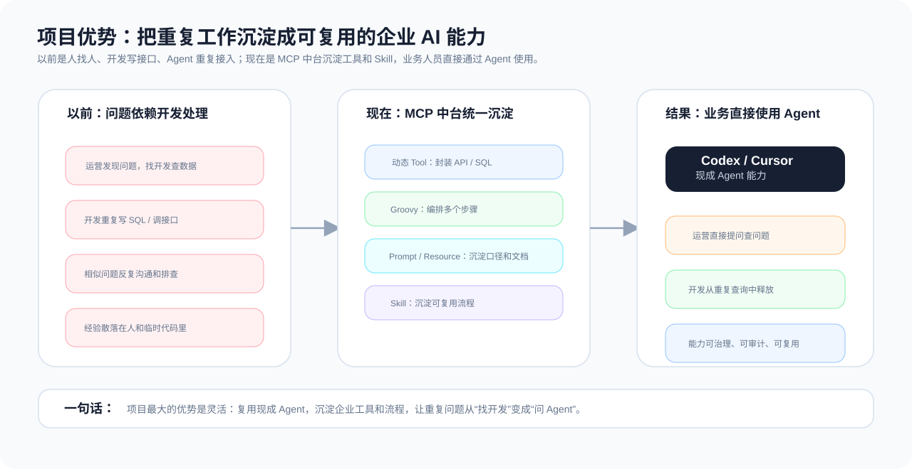

### 以前的问题

在没有 MCP 中台之前，很多重复性问题通常是这样处理的：

1. 运营、客服或业务人员发现问题。
2. 他们不一定能直接查数据库或内部系统，只能找开发帮忙。
3. 开发再去查日志、查 SQL、调接口、拼结果。
4. 下次遇到类似问题，又要再问一遍、再查一遍。
5. 一些经验只存在于开发的脑子里、临时 SQL 里或聊天记录里，很难复用。

这种方式的问题不是某一次查询慢，而是企业里大量“复杂但重复”的工作没有被沉淀下来。比如订单异常排查、用户状态查询、退款原因分析、运营指标统计、业务数据核对、内部制度问答，这些事情每次都让开发介入，会消耗大量重复精力。

### 有了 MCP 中台之后

有了这个项目之后，可以把这些重复流程沉淀成标准能力：

1. 把底层 API 配成 `mcp_request_config`。
2. 把数据库读取配成受控数据源。
3. 把具体业务动作封装成动态 Tool。
4. 用 Groovy 把多个 API、SQL 和处理逻辑编排成 workflow。
5. 用 Prompt 固化分析步骤、输出格式和业务口径。
6. 用 Resource 接入公司内部文档、规则、手册和指标说明。
7. 用 Skill 把工具、提示词、文档和执行步骤打包成可复用能力。
8. 把飞书等第三方 MCP Server 接到 Bear 后面，统一变成企业可治理能力。

这样以后遇到相似问题，不需要每次都找开发重新查。开发可以把一次排查经验沉淀成 Tool 或 Skill，运营人员后续直接在 Codex、Cursor、Claude 或公司自研 Agent 里提问，Agent 通过 MCP 调用对应能力完成查询、分析和解释。

### 对企业的价值

第一，降低重复开发成本。

以前每做一个 Agent，都要重新接 API、写权限、写审计、解释参数和返回值。现在这些能力在 MCP 中台里统一沉淀，Agent 只需要按 MCP 协议发现和调用。

第二，提高业务响应速度。

运营人员遇到重复问题，不一定要排队等开发查 SQL 或调接口。只要对应能力已经沉淀成 Tool 或 Skill，就可以直接问 Agent，由 Agent 自动调用工具完成排查。

第三，让经验可以复用。

很多业务流程不是单个接口能解决的，而是“先查 A，再查 B，再判断 C，最后输出结论”。这些流程可以通过 Groovy 和 Skill 固化下来，变成公司可复用的 AI 能力资产。

第四，减少模型选择负担。

通过 Token 工具选择和 Skill 打包，不需要把所有工具一次性暴露给模型。不同场景加载不同工具包，模型更容易选对工具，调用结果也更稳定。

第五，复用现成 Agent 能力。

公司不一定要自己从零开发完整 Agent。Codex、Cursor、Claude 等工具已经具备强大的理解、规划和执行能力。这个项目把企业能力按 MCP 标准暴露出去，相当于把公司内部系统接到这些现成 Agent 上，让公司更快获得 AI 应用能力。

第六，安全和治理没有丢。

灵活不等于失控。项目里有 Token 鉴权、角色权限、Token 工具选择、API 白名单、数据源白名单、SQL 只读限制、Groovy 安全控制和审计日志。业务能力可以快速接入，但仍然在平台边界内运行。

第七，第三方 MCP 能力也能统一出口。

公司以后可能会接飞书、企业协作平台、SaaS 平台、开放平台等第三方 MCP Server。如果每个 Agent 都直接连这些平台，权限、凭证和审计会分散。Bear MCP 可以作为统一代理层，把第三方 MCP 工具也纳入公司自己的 Token、角色、白名单和审计体系。

第八，后续扩展空间大。

当公司接入更多业务系统时，只需要继续沉淀 API 配置、动态 Tool、Prompt、Resource 和 Skill。MCP Client 侧不用为每个系统单独开发适配逻辑，平台可以逐步变成企业统一的 AI 能力目录。

典型表达：

> 这个项目的价值不是简单让 AI 调接口，而是让公司把复杂、重复、需要经验的工作沉淀成可复用的 MCP 能力。以前运营查问题要找开发，开发反复查接口、查 SQL、拼结果；现在可以把这些流程做成动态 Tool 和 Skill，让运营直接问 Codex 这类 Agent。Agent 通过 Bear MCP 中台安全调用公司内部工具和第三方 MCP 能力，既复用现成 Agent 能力，又保留权限、白名单和审计治理。

## 19. 代码包分层与核心代码讲解

最后看代码时，可以先看整体包图，再按“一个 MCP 请求进来以后经过哪些层”来讲。这样能把前面的架构、权限、动态工具、Groovy、API、数据源、Prompt/Resource/Skill 和审计全部串起来。

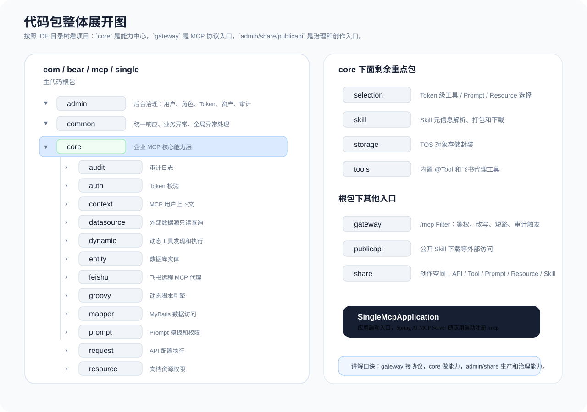

整体包结构可以先这样理解：

```text
com.bear.mcp.single
├── admin        后台治理：用户、角色、Token、资产、审计
├── common       统一响应、业务异常、全局异常处理
├── core         企业 MCP 核心能力
│   ├── audit        审计日志
│   ├── auth         Token 校验
│   ├── context      MCP 用户上下文
│   ├── datasource   外部数据源只读查询
│   ├── dynamic      动态工具发现和执行
│   ├── entity       数据库实体
│   ├── feishu       飞书远程 MCP 代理
│   ├── groovy       动态脚本引擎
│   ├── mapper       MyBatis 数据访问
│   ├── prompt       Prompt 模板和权限
│   ├── request      API 配置执行
│   ├── resource     文档资源权限
│   ├── selection    Token 级工具选择
│   ├── skill        Skill 能力包
│   ├── storage      TOS 存储
│   └── tools        内置 @Tool
├── gateway      MCP 协议入口和 Filter 扩展
├── publicapi    公开下载和外部访问入口
├── share        能力创作空间
└── SingleMcpApplication
```

如果说上面这张图回答的是“代码包怎么分”，下面这张图回答的是“请求进来以后这些包怎么协作”。

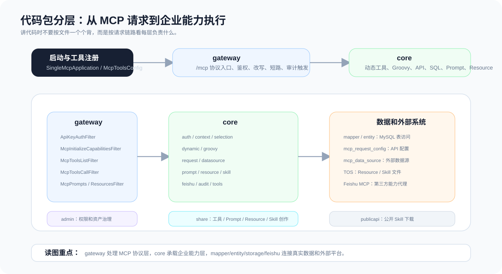

### 核心代码按链路详细讲

如果要讲得更细，可以按一次真实 MCP 请求从入口到执行结果的顺序来讲。

**1. TokenService：把一把 Token 解析成用户能力**

`TokenService.validate(token)` 是鉴权链路的底层逻辑。它不是简单查 Token 是否存在，而是一次性把后续权限判断需要的信息都算出来。

关键逻辑：

```java
McpUserTokenEntity tokenEntity = tokenMapper.findActiveByTokenHash(sha256(token.trim()));
if (tokenEntity == null || expired(tokenEntity)) {
    return Optional.empty();
}
McpUserEntity userEntity = userMapper.findEnabledById(tokenEntity.getUserId());
```

这里有三个安全点：

1. 数据库不保存明文 Token，只保存 SHA-256 摘要。
2. Token 必须启用且未过期。
3. Token 对应的用户也必须启用。

然后它继续查用户角色和角色权限：

```java
Set<String> activeRoleCodes = roleMapper.findEnabledByRoleCodes(requestedRoleCodes)
        .stream()
        .map(McpRoleEntity::getRoleCode)
        .collect(Collectors.toSet());

Set<String> allowedTools = roleToolMapper.findByRoleCodes(activeRoleCodes)
        .stream()
        .map(McpRoleToolEntity::getToolName)
        .collect(Collectors.toSet());
```

这一步算出来的 `allowedTools/allowedPrompts/allowedResources` 是“角色授权上限”，还不是最终给模型看的列表。最终列表还要在 `tools/list`、`prompts/list`、`resources/list` 里和当前 Token 选择取交集。

可以这样讲：

> `TokenService` 负责把一把 MCP Token 翻译成当前调用人的身份和权限上限。它不直接决定模型能看到哪些工具，而是提供后续 Filter 做二次筛选的基础。

**2. ApiKeyAuthFilter：在 Spring AI 前面建立用户上下文**

`ApiKeyAuthFilter` 是所有 `/mcp` 请求的第一道门。它只保护 MCP 协议入口，不影响管理后台和创作空间。

关键逻辑：

```java
if (mcpRequest) {
    String token = extractToken(currentRequest);
    TokenAuthInfo tokenAuthInfo = tokenService.validate(token).orElse(null);
    if (tokenAuthInfo == null) {
        response.setStatus(HttpServletResponse.SC_UNAUTHORIZED);
        response.getWriter().write("{\"error\":\"Invalid MCP token\"}");
        return;
    }
    McpUserContextHolder.set(new McpUserContext(...));
}
```

这里最重要的是 `McpUserContextHolder.set(...)`。因为 `/mcp` 不是项目自己写的 Controller，而是 Spring AI 自动注册的 Handler，所以项目需要在 Filter 层把用户信息放进 ThreadLocal。后续 Filter、内置工具和动态工具就能在同一个请求线程里拿到当前用户。

请求结束后还必须清理：

```java
finally {
    McpUserContextHolder.clear();
}
```

这个细节也值得讲。Tomcat 工作线程会复用，如果不清理 ThreadLocal，下一次请求可能读到上一个用户的上下文。

**3. McpInitializeCapabilitiesFilter：告诉客户端支持 Prompt 和 Resource**

MCP Client 会先发 `initialize`。如果服务端没有在 capability 里声明支持 `prompts` 或 `resources`，客户端后续可能不会主动调用 `prompts/list`、`resources/list`。

关键逻辑：

```java
ObjectNode prompts = objectMapper.createObjectNode();
prompts.put("listChanged", false);
capabilities.set("prompts", prompts);

ObjectNode resources = objectMapper.createObjectNode();
resources.put("subscribe", false);
resources.put("listChanged", false);
capabilities.set("resources", resources);
```

这段代码的意义是：Spring AI 原生能力主要覆盖内置 Tool，项目通过 initialize 响应改写，告诉客户端“我还支持动态 Prompt 和 Resource”。后面的 Prompt/Resource Filter 才有机会被客户端调用。

**4. McpToolsListFilter：把工具列表变成当前 Token 的工具包**

`tools/list` 是模型选工具之前最关键的一步。这个 Filter 的设计点是“先让 Spring AI 出原始列表，再由项目改写”。

核心流程：

```java
filterChain.doFilter(requestWrapper, responseWrapper);
String original = new String(responseWrapper.getContentAsByteArray(), StandardCharsets.UTF_8);
String modified = modifyToolsList(original, context);
```

`modifyToolsList` 里面做两件事：

第一，过滤 Spring AI 原生内置工具：

```java
boolean selectedBuiltin = allowed.stream()
        .anyMatch(t -> DynamicToolService.TYPE_BUILTIN.equals(t.type()) && name.equals(t.name()));
if (selectedBuiltin) {
    newTools.add(originalTool);
}
```

第二，注入数据库动态工具：

```java
dynamicTool.put("name", toolInfo.name());
dynamicTool.put("description", toolInfo.description());
dynamicTool.put("inputSchema", inputSchema);
newTools.add(dynamicTool);
```

这里和前面第 8 章的“两层权限模型”是对应的：`allowed` 不是全量工具，而是 `DynamicToolService.getUserFinalTools(userId, tokenId, context.allowedTools())` 算出来的结果。也就是角色授权上限和 Token 工具选择取交集。

可以这样讲：

> `tools/list` 决定模型这一轮能看到哪些工具。我们不把所有工具都塞进去，而是按当前 Token 生成一个小而准的工具包，既减少上下文成本，也降低模型误选工具的概率。

**5. McpToolsCallFilter：统一鉴权，然后分流内置工具和动态工具**

`tools/call` 是真正执行工具的入口。这里最关键的是 `canCall`：

```java
private boolean canCall(McpUserContext context, String toolName) {
    return context != null
            && context.allowedTools().contains(toolName)
            && toolSelectionService.isToolSelected(context.tokenId(), toolName);
}
```

这段代码保证调用和发现使用同一套权限逻辑。即使某个工具没有出现在 `tools/list`，只要有人手写 `tools/call` 请求来调，也会再次被拦住。

然后分两条路：

```java
if (toolName == null || dynamicToolService.findEnabledByName(toolName).isEmpty()) {
    doBuiltinToolCall(cachedRequest, response, filterChain, body, toolName, context);
    return;
}

ScriptResult result = dynamicToolService.execute(toolName, argumentsOf(body));
response.getWriter().write(buildJsonRpcResponse(requestIdOf(body), result));
```

内置工具继续交给 Spring AI，因为它有对应的 `@Tool` Java 方法；动态工具不进入 Spring AI，因为 Spring AI 不知道数据库里的 Groovy 工具，所以项目直接短路执行。

**6. DynamicToolService：动态工具的发现和执行中心**

`DynamicToolService` 同时服务两个协议方法。

在 `tools/list` 阶段，它计算最终工具：

```java
List<String> selected = toolSelectionService.listSelectedTools(tokenId);
for (String toolName : selected) {
    if (allowedTools == null || !allowedTools.contains(toolName)) {
        continue;
    }
    Optional<DynamicTool> dynamicTool = findEnabledByName(toolName);
    ...
}
```

这个逻辑体现了“Token 选择优先缩小范围，再用角色权限做上限校验”。如果是动态工具，就带上 description 和 inputSchema；如果是内置工具，只保留名称，让 Spring AI 原始 schema 补齐。

在 `tools/call` 阶段，它执行动态工具：

```java
DynamicTool tool = findEnabledByName(toolName)
        .orElseThrow(() -> new IllegalArgumentException("动态工具不存在或已禁用: " + toolName));

result = groovyScriptEngine.execute(tool.script(), new ScriptContext(
        params,
        userId,
        userName,
        toolName,
        tool.linkedRequestKeys(),
        tool.linkedDataSourceIds(),
        30000
));
```

这里把 `linkedRequestKeys` 和 `linkedDataSourceIds` 一起传给 Groovy。也就是说，工具能调哪些 API、能查哪些数据源，不是脚本说了算，而是工具配置提前绑定好的。

最后在 `finally` 里写审计：

```java
finally {
    auditLogService.recordToolCall(...);
}
```

这保证动态工具成功、失败、异常都会落审计。

**7. GroovyScriptEngine：灵活编排和安全边界都在这里**

Groovy 执行分三层保护。

第一层，执行前做字符串安全检查：

```java
GroovySecurityCustomizer.validate(script);
```

第二层，用 `CompilerConfiguration` 加 AST 限制：

```java
configuration.addCompilationCustomizers(imports, GroovySecurityCustomizer.create());
```

第三层，用独立线程池和超时控制执行：

```java
Future<Object> future = executor.submit(() -> {
    GroovyShell shell = new GroovyShell(binding, compilerConfiguration);
    Script compiledScript = shell.parse(script);
    return compiledScript.run();
});
Object result = future.get(timeout, TimeUnit.MILLISECONDS);
```

这说明 Groovy 不是随便在 Web 线程里裸跑脚本。它有编译限制、执行隔离和超时保护。

脚本能用什么，由 `createBinding` 决定：

```java
binding.setVariable("params", context.params() != null ? context.params() : Map.of());
binding.setVariable("userId", context.userId());
binding.setVariable("userName", context.userName());
binding.setVariable("toolName", context.toolName());
binding.setVariable("runRequest", new ScriptRunRequest(requestConfigService, context.linkedRequestKeys()));
binding.setVariable("runSql", new ScriptRunSql(sqlExecutor, context.linkedDataSourceIds()));
```

这里是整个动态工具安全设计的关键：脚本只能通过平台给的 `runRequest` 和 `runSql` 访问外部能力，不能直接绕开治理。

**8. ScriptRunRequest：API 白名单在脚本入口就拦住**

Groovy 脚本调用 API 看起来很简单：

```groovy
def result = runRequest.runRequest("order_detail_api", params)
return result
```

但 Java 入口会先检查 key：

```java
if (!allowedKeys.contains(key)) {
    throw new IllegalArgumentException("未关联的请求配置: " + key);
}
return requestConfigService.execute(key, params != null ? params : Map.of());
```

所以脚本不能随便写一个 key 就访问任意 API。只有当前动态工具绑定过的 `linked_request_keys` 才能被调用。

**9. RequestConfigService：把 API 调用从脚本里抽成配置资产**

`RequestConfigService.execute` 先查配置、校验启用、合并默认参数和运行时参数：

```java
RequestConfig config = findByKey(key);
if (config == null) {
    throw new IllegalArgumentException("请求配置不存在: " + key);
}
Map<String, Object> finalParams = mergeParams(config.paramsDefault(), params);
checkRateLimit(config);
```

然后它只允许当前已实现的 HTTP 类型进入执行：

```java
if (!"HTTP".equalsIgnoreCase(config.type())) {
    throw new IllegalArgumentException("当前单体版未接入 " + config.type() + " 客户端");
}
return executeHttp(config, finalParams);
```

HTTP 执行时会做模板替换：

```java
String url = replace(config.url(), params);
String body = replace(config.bodyTemplate(), params);
```

这就是为什么第 13 章说 API 配置很重要。脚本不用自己拼 URL、Header、Body 和超时；这些都由 `mcp_request_config` 管理。接口变更时改配置即可，工具脚本只保留业务编排逻辑。

**10. ScriptRunSql 和 ExternalDataSourceSqlExecutor：让工具能查库，但只能受控只读**

脚本查询数据源时可以写：

```groovy
def rows = runSql.runSql(1L, "select id, name from user limit 10")
return rows
```

但 `ScriptRunSql` 会先检查数据源是否绑定：

```java
if (!allowedDataSourceIds.contains(id)) {
    throw new IllegalArgumentException("未关联的数据源: " + id);
}
return sqlExecutor.query(id, sql);
```

真正执行 SQL 前，`ExternalDataSourceSqlExecutor` 再做只读校验：

```java
if (trimmed.contains(";")) {
    throw new IllegalArgumentException("只允许单条 SELECT SQL，不允许包含分号");
}
if (!trimmed.regionMatches(true, 0, "SELECT", 0, 6)) {
    throw new IllegalArgumentException("只允许执行 SELECT 查询");
}
```

执行结果也有限制：

```java
if (count >= MAX_QUERY_ROWS) {
    truncated = true;
    break;
}
```

这样 Tool 可以直接查数据库，但查询能力被限制在“已绑定数据源 + 单条 SELECT + 最大行数”之内。

**11. McpPromptsFilter：Prompt 不走 Spring AI 静态注册，而是项目短路返回**

Prompt 是数据库资产，所以 `prompts/list` 和 `prompts/get` 由项目自己处理：

```java
if (PROMPTS_LIST.equals(method)) {
    response.getWriter().write(buildListResponse(requestIdOf(body)));
    return;
}
response.getWriter().write(buildGetResponse(requestIdOf(body), body));
```

`buildListResponse` 会调用：

```java
promptAccessService.listAccessiblePrompts(context)
```

这表示 Prompt 也不是全量返回，而是根据角色权限和 Token 选择返回当前可见的 Prompt。`buildGetResponse` 则会校验权限，然后渲染模板：

```java
String rendered = promptTemplateService.render(entity.getTemplateContent(), arguments);
```

这段代码对应第 15 章的价值：把可复用的分析流程、输出口径、话术模板沉淀成可治理的 MCP Prompt。

**12. McpResourcesFilter：内部文档资源按权限读取**

Resource 也是项目短路处理：

```java
if (RESOURCES_LIST.equals(method)) {
    response.getWriter().write(buildListResponse(requestIdOf(body)));
    return;
}
response.getWriter().write(buildReadResponse(requestIdOf(body), body));
```

读取时先查权限：

```java
McpResourceEntity entity = resourceAccessService.findAccessibleByUri(context, uri);
if (entity == null) {
    return buildErrorResponse(...);
}
```

再读取内容：

```java
content.put("text", resourceAccessService.readText(entity));
```

这样公司内部文档、指标口径、SOP、排障手册不是直接丢给模型，而是通过 MCP Resource 以 URI 为单位做权限控制和审计。

**13. FeishuRemoteMcpService：第三方 MCP 也走 Bear 统一出口**

飞书工具层对 Agent 暴露的是 Bear 自己的 `@Tool`：

```java
@Tool(name = "feishu_mcp_fetch_doc")
public Map<String, Object> fetchFeishuDoc(String doc_id, String doc_url) {
    return feishuRemoteMcpService.callTool("fetch-doc", args);
}
```

服务层再组装 JSON-RPC 请求去调飞书官方 MCP：

```java
body.put("jsonrpc", "2.0");
body.put("method", method);
body.put("params", params);
```

凭证也在服务端处理：

```java
.header(credential.headerName(), credential.token())
.header("X-Lark-MCP-Allowed-Tools", allowedTools)
```

这段代码说明第三方 MCP 不是由 Agent 自己直接连，而是由 Bear 统一代理。Agent 看见的是 Bear Tool，公司管理的是 Bear Token、Bear 权限和 Bear 审计。

**14. AuditLogService：所有链路最后都要可复盘**

审计服务统一把运行时审计对象转成数据库实体：

```java
entity.setUserId(auditLog.userId());
entity.setUserName(auditLog.userName());
entity.setToolName(truncateToolName(auditLog.toolName()));
entity.setRequestParams(auditLog.requestSummary());
entity.setResponseSummary(auditLog.responseSummary());
entity.setStatus(auditLog.status());
entity.setErrorMessage(auditLog.errorMessage());
entity.setDurationMs(auditLog.durationMs());
```

参数、响应和错误都会截断：

```java
return value.length() > 500 ? value.substring(0, 500) : value;
```

这不是为了省事，而是审计系统必须控制日志体积，不能因为一次大响应把数据库撑爆。

这一段可以作为核心代码讲解的收束：

> 网关负责拦住请求，权限负责算出边界，动态工具负责执行，Groovy 负责编排，API/SQL/飞书负责连接真实系统，审计负责把每次调用留下证据。这几段代码串起来，就是企业 MCP 中台的核心闭环。

### 第一层：启动入口和工具注册

启动入口是：

```text
com.bear.mcp.single.SingleMcpApplication
```

它负责启动整个 Spring Boot 应用。真正让 Java 方法变成 MCP Tool 的关键配置在：

```text
com.bear.mcp.single.core.tools.McpToolsConfig
```

这里会把一组带 `@Tool` 的 Bean 交给 Spring AI MCP Server，例如系统工具、请求配置工具、数据源工具、Prompt/Resource/Skill 工具、飞书远程 MCP 工具等。Spring AI 启动后会扫描这些 `@Tool` 方法，并把它们注册成内置 MCP Tool。

这一层可以这样讲：

> Spring AI 负责把启动期固定工具注册成 MCP Tool，项目自己的动态能力再通过 gateway Filter 注入和分流。

### 第二层：MCP 协议网关层 `gateway`

核心包：

```text
com.bear.mcp.single.gateway
```

这一层是整个项目最关键的入口层，因为所有 MCP Client 最终都会请求 `POST /mcp`。项目没有重写 Spring AI 的 MCP Controller，而是在 Servlet Filter 层按 JSON-RPC `method` 做扩展。

核心类：

| 类 | 作用 |
| --- | --- |
| `ApiKeyAuthFilter` | 校验 Bearer Token，构建当前 MCP 用户上下文 |
| `McpInitializeCapabilitiesFilter` | 改写 `initialize` 响应，补充 Prompt / Resource capability |
| `McpToolsListFilter` | 改写 `tools/list`，过滤内置工具并注入动态工具 |
| `McpToolsCallFilter` | 统一校验 `tools/call`，内置工具放行，动态工具短路执行 |
| `McpPromptsFilter` | 短路处理 `prompts/list` 和 `prompts/get` |
| `McpResourcesFilter` | 短路处理 `resources/list` 和 `resources/read` |

这一层的核心价值是：在不 fork Spring AI 的前提下，补上企业 MCP 中台需要的动态能力、权限过滤、短路执行和审计。

可以按这个顺序讲请求：

```text
POST /mcp
        ↓
ApiKeyAuthFilter 鉴权
        ↓
按 JSON-RPC method 进入不同 Filter
        ↓
initialize 改 capability
tools/list 改工具列表
tools/call 做鉴权和分流
prompts/resources 由项目短路返回
```

### 第三层：身份、上下文和权限

核心包：

```text
com.bear.mcp.single.core.auth
com.bear.mcp.single.core.context
com.bear.mcp.single.core.selection
```

`TokenService` 负责校验 Token。它会把明文 Token 做摘要，再去查 `mcp_user_token`，同时加载用户、角色和角色授权的能力集合。

`McpUserContext` 是一次 MCP 请求里的用户上下文，里面包含用户 ID、用户名、角色、可用 Tools、Prompts、Resources 等信息。`McpUserContextHolder` 用 ThreadLocal 保存上下文，让后面的 Filter 和 Service 能拿到当前调用人。

`ToolSelectionService` 负责 Token 级工具选择。它和角色授权一起形成两层权限：

```text
最终可用能力 = 角色授权上限 ∩ 当前 Token 选择
```

这一层要强调：项目不是只做 Token 鉴权，而是把“用户理论上能用什么”和“当前 Agent 会话实际加载什么”拆开治理。

### 第四层：动态工具执行

核心包：

```text
com.bear.mcp.single.core.dynamic
com.bear.mcp.single.core.groovy
```

`DynamicToolService` 是动态工具的核心服务。它主要做两件事：

1. 在 `tools/list` 阶段，根据当前用户和 Token 计算最终能看到哪些动态工具。
2. 在 `tools/call` 阶段，根据工具名查动态工具配置，校验权限后执行 Groovy 脚本。

`GroovyScriptEngine` 是脚本执行引擎。它负责把数据库里的 `groovy_script` 编译执行，并注入脚本可用变量：

```text
params
userId
userName
toolName
runRequest
runSql
```

`GroovySecurityCustomizer` 负责脚本安全限制，配合执行前字符串检查、线程池隔离和超时控制，避免动态脚本失控。

这一层可以这样讲：

> 动态工具不是 Spring AI 的 `@Tool` 方法，而是数据库里的运行时资产。Filter 命中动态工具后不会交给 Spring AI，而是短路到 `DynamicToolService`，再由 Groovy 编排 API、SQL 和结果处理。

### 第五层：API、数据源和第三方 MCP 能力

核心包：

```text
com.bear.mcp.single.core.request
com.bear.mcp.single.core.datasource
com.bear.mcp.single.core.feishu
```

`RequestConfigService` 是 `runRequest` 背后的执行服务。它根据 `config_key` 查 `mcp_request_config`，再按配置的 URL、Method、Header、Body 模板、默认参数、超时和限流发起 HTTP 请求。这样 Groovy 不需要直接写一堆 HTTP 细节，也不能随便访问未绑定的 API。

`ExternalDataSourceSqlExecutor` 是 `runSql` 背后的执行器。它负责控制 SQL 边界：只允许单条 `SELECT`，限制 SQL 长度、最大返回行数，并要求动态工具提前绑定数据源。

`ExternalDataSourcePoolManager` 负责外部数据源连接池管理，避免每次查询都临时创建连接。

`FeishuRemoteMcpService` 和 `FeishuRemoteMcpTools` 负责飞书远程 MCP 接入。Bear 对外暴露 `feishu_mcp_*` 工具，服务端持有飞书凭证并代理飞书官方 MCP，把第三方 MCP 能力纳入 Bear 的统一入口和治理体系。

这一层是项目连接真实世界的地方：

```text
动态 Tool
  ├─ runRequest -> 内部 API / 外部 API
  ├─ runSql -> 已授权数据源
  └─ feishu_mcp_* -> 飞书远程 MCP
```

### 第六层：Prompt、Resource、Skill

核心包：

```text
com.bear.mcp.single.core.prompt
com.bear.mcp.single.core.resource
com.bear.mcp.single.core.skill
com.bear.mcp.single.core.storage
```

`PromptAccessService` 和 `PromptTemplateService` 负责 Prompt 的权限判断、模板查询和参数渲染。`McpPromptsFilter` 会调用它们返回 MCP 标准的 Prompt 响应。

`ResourceAccessService` 负责 Resource 权限判断，`TosStorageService` 负责从 TOS 读取资源文件内容。`McpResourcesFilter` 会把内部文档、业务说明、指标口径等资源包装成 MCP Resource 返回。

`SkillMarkdownService` 和 `SkillPackageService` 负责 Skill 的元信息解析和打包下载。Skill 不是单个工具，而是把工具、Prompt、Resource 和流程说明组合成可复用能力包。

这一层要和业务价值连起来讲：Tool 负责执行，Prompt 固化流程，Resource 提供知识依据，Skill 负责打包复用。

### 第七层：审计和数据访问

核心包：

```text
com.bear.mcp.single.core.audit
com.bear.mcp.single.core.entity
com.bear.mcp.single.core.mapper
```

`AuditLogService` 负责统一写入 `mcp_audit_log`。内置工具、动态工具、Prompt、Resource 调用都会尽量落审计，记录调用人、工具名、请求摘要、响应摘要、状态、错误和耗时。

`entity` 包是数据库表对象，例如用户、角色、Token、动态工具、Prompt、Resource、Skill、请求配置、数据源、审计日志等。

`mapper` 包是 MyBatis 数据访问层，负责把业务服务和 MySQL 表连接起来。对应的 SQL XML 在：

```text
bear-mcp-single/src/main/resources/mapper
```

这一层可以这样讲：

> 企业 MCP 中台的治理能力最终都要落到数据模型里：用户、角色、Token、选择表、工具资产、API 配置、数据源、审计日志，共同支撑运行时权限和可追踪。

### 第八层：管理端、创作空间和公开接口

核心包：

```text
com.bear.mcp.single.admin
com.bear.mcp.single.share
com.bear.mcp.single.publicapi
```

`admin` 包面向平台管理，负责用户、角色、Token、工具选择、Prompt/Resource 选择、数据源、请求配置、动态工具、审计日志等后台治理。

`share` 包面向能力创作，负责 API 调试、动态工具调试、Prompt 调试、Resource 上传、Skill 创作和社区能力。

`publicapi` 包提供公开下载能力，比如 Skill 包下载，让能力可以被外部工具或客户端获取。

这一层不是 MCP 调用的主链路，但它决定了 MCP 能力如何被生产、配置、发布和复用。

### 最后一遍串起来

如果面试官问“这个项目代码怎么组织”，可以这样回答：

> 项目代码大体分三块：第一块是 `gateway`，负责 `/mcp` 协议入口，在 Filter 层做 Token 鉴权、initialize capability 改写、tools/list 注入动态工具、tools/call 鉴权分流，以及 Prompt/Resource 的短路响应；第二块是 `core`，负责真正的企业能力，包括 Token、权限、动态工具、Groovy、API 配置、数据源查询、Prompt、Resource、Skill、飞书 MCP 代理和审计；第三块是 `admin/share/publicapi`，负责这些能力的管理、创作、调试、发布和下载。这样代码结构和业务目标是一致的：网关负责接入，核心负责能力，后台负责治理和生产。
