# 知识库后端与 Python 向量入库流程

本文梳理后台管理端知识库模块从 Web 接口进入 Java 后端，再由 Java 调用 Python AI 服务，最后由 Python 写入 Milvus 向量库的完整流程。

涉及工程：

- `YanQue-Admin-Web-14`：后台管理前端。
- `YanQue-Admin-14`：Java 业务后端，负责鉴权、MySQL 元数据、TOS 预签名、调用 Python。
- `YanQue-AI-14`：Python AI 服务，负责 Milvus Collection 管理、Markdown 下载、切分、Embedding、向量入库。

## 1. 总体链路

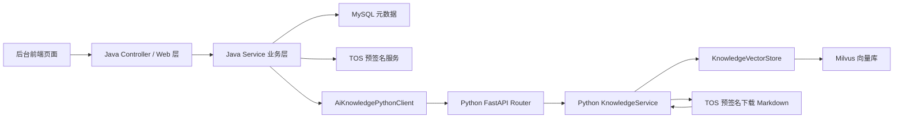

Java 后端管业务状态，Python 后端管向量侧动作。

Java 侧保存的数据包括：知识库编码、文档名称、文档编码、TOS 路径、文档状态、版本号、切片数、错误信息。

Python 侧保存的数据主要在 Milvus Collection 中，包括：文档切片文本、稠密向量、BM25 稀疏向量、知识库 ID、文档 ID、文档编码、版本、TOS 路径等元数据。

## 2. 前端 API 入口

文件：

- `YanQue-Admin-Web-14/src/api/system.ts`
- `YanQue-Admin-Web-14/src/pages/KnowledgeBasesPage.tsx`
- `YanQue-Admin-Web-14/src/pages/KnowledgeDocumentsPage.tsx`

知识库 API：

| 操作 | 前端方法 | Java 接口 |
| --- | --- | --- |
| 查询知识库列表 | `knowledgeBaseApi.page` | `GET /api/ai/knowledge-bases` |
| 查询知识库详情 | `knowledgeBaseApi.detail` | `GET /api/ai/knowledge-bases/{id}` |
| 创建知识库 | `knowledgeBaseApi.create` | `POST /api/ai/knowledge-bases` |
| 编辑知识库 | `knowledgeBaseApi.update` | `PUT /api/ai/knowledge-bases/{id}` |
| 启用/禁用知识库 | `knowledgeBaseApi.updateStatus` | `PUT /api/ai/knowledge-bases/{id}/status` |
| 删除知识库 | `knowledgeBaseApi.remove` | `DELETE /api/ai/knowledge-bases/{id}` |

文档 API：

| 操作 | 前端方法 | Java 接口 |
| --- | --- | --- |
| 查询文档列表 | `knowledgeDocumentApi.page` | `GET /api/ai/knowledge-bases/{knowledgeBaseId}/documents` |
| 获取上传预签名 | `knowledgeDocumentApi.presignUpload` | `POST /api/ai/knowledge-bases/{knowledgeBaseId}/documents/presign-upload` |
| 新增文档记录并触发入库 | `knowledgeDocumentApi.create` | `POST /api/ai/knowledge-bases/{knowledgeBaseId}/documents` |
| 重建文档向量 | `knowledgeDocumentApi.rebuild` | `POST /api/ai/knowledge-bases/{knowledgeBaseId}/documents/{documentId}/rebuild` |
| 删除文档 | `knowledgeDocumentApi.remove` | `DELETE /api/ai/knowledge-bases/{knowledgeBaseId}/documents/{documentId}` |

前端请求统一从 `http.ts` 进入，会带上：

- `Authorization: Bearer <token>`
- `X-Timestamp`
- `X-Nonce`
- `X-Sign`

Java 侧会经过 token、权限、签名拦截器。

## 3. Java Web 层入口

知识库 Controller：

```text
cn.yanque.modules.aiknowledge.controller.AiKnowledgeBaseController
```

文档 Controller：

```text
cn.yanque.modules.aiknowledge.controller.AiKnowledgeDocumentController
```

这两个 Controller 只负责接收参数、校验、调用 Service、包装 `ApiResponse`。

真正业务逻辑在：

```text
cn.yanque.modules.aiknowledge.service.impl.AiKnowledgeBaseServiceImpl
cn.yanque.modules.aiknowledge.service.impl.AiKnowledgeDocumentServiceImpl
```

Java 调 Python 的统一入口是：

```text
cn.yanque.modules.aiknowledge.service.AiKnowledgePythonClient
```

Python 服务地址通过配置项读取：

```properties
yanque-ai.base-url=http://localhost:8000
```

默认会调用本机 `8000` 端口的 Python 服务。

## 4. 创建知识库流程

接口：

```http
POST /api/ai/knowledge-bases
```

请求体核心字段：

```json
{
  "name": "课程资料库",
  "code": "course_material",
  "description": "课程相关文档"
}
```

Java 流程：

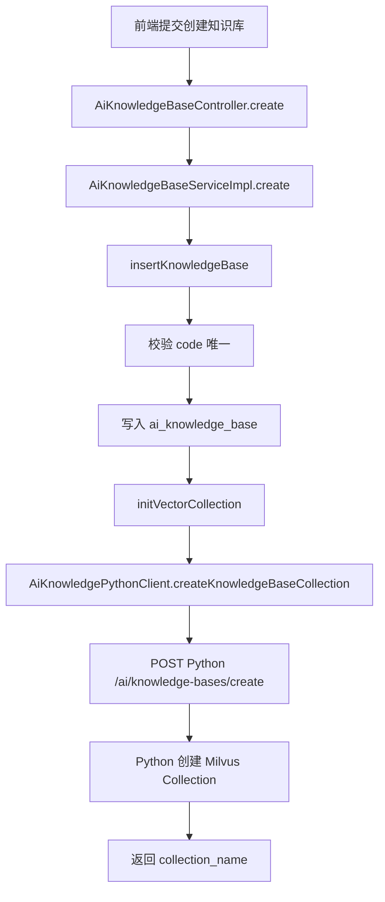

Java 侧关键方法：

```text
AiKnowledgeBaseController.create
AiKnowledgeBaseServiceImpl.create
AiKnowledgeBaseServiceImpl.insertKnowledgeBase
AiKnowledgeBaseServiceImpl.initVectorCollection
AiKnowledgePythonClient.createKnowledgeBaseCollection
```

Java 先写 MySQL，再调用 Python 创建 Milvus Collection。

如果 Python 或 Milvus 初始化失败，Java 会执行补偿：

```text
cleanupCreatedKnowledgeBase
```

也就是删除刚刚插入的 MySQL 知识库记录，避免出现 MySQL 有记录但 Milvus 没有表的半成品状态。

Python 流程：

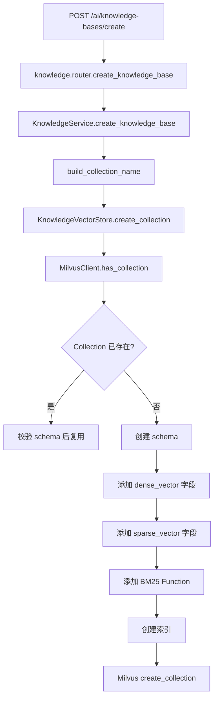

Python 关键文件：

```text
YanQue-AI-14/src/yanque_ai/modules/knowledge/router.py
YanQue-AI-14/src/yanque_ai/modules/knowledge/service.py
YanQue-AI-14/src/yanque_ai/modules/knowledge/vector_store.py
```

注意：Milvus Collection 名必须以字母或下划线开头。当前 Python 已做兜底：

```text
001 -> kb_001_e193a01e
course_material -> course_material
_001 -> _001
```

## 5. 上传文档预签名流程

接口：

```http
POST /api/ai/knowledge-bases/{knowledgeBaseId}/documents/presign-upload
```

这个接口只负责生成上传地址，不会写 MySQL，也不会调用 Python。

Java 流程：

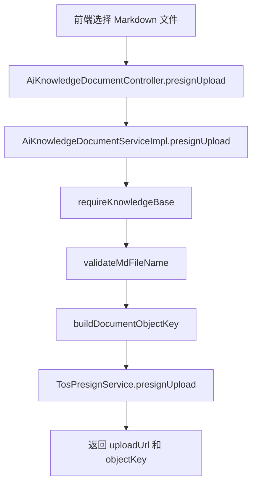

objectKey 规则：

```text
ai/knowledge/{knowledgeBaseCode}/documents/{uuid}.md
```

例如：

```text
ai/knowledge/course_material/documents/6c9f....md
```

前端拿到预签名地址后，直接把文件上传到 TOS。

## 6. 新增文档并入库流程

接口：

```http
POST /api/ai/knowledge-bases/{knowledgeBaseId}/documents
```

请求体核心字段：

```json
{
  "name": "lesson01.md",
  "code": "lesson01",
  "objectKey": "ai/knowledge/course_material/documents/xxx.md",
  "fileSize": 1024
}
```

Java 同步阶段：

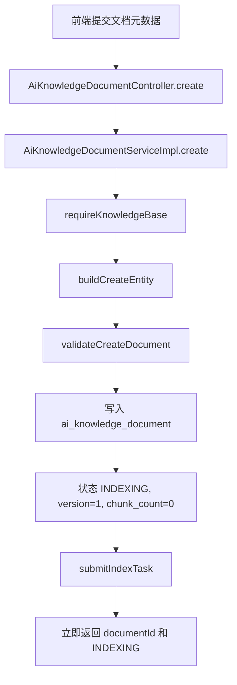

这里 Java 不会等 Python 完成入库，而是异步提交后台任务。

后台异步阶段：

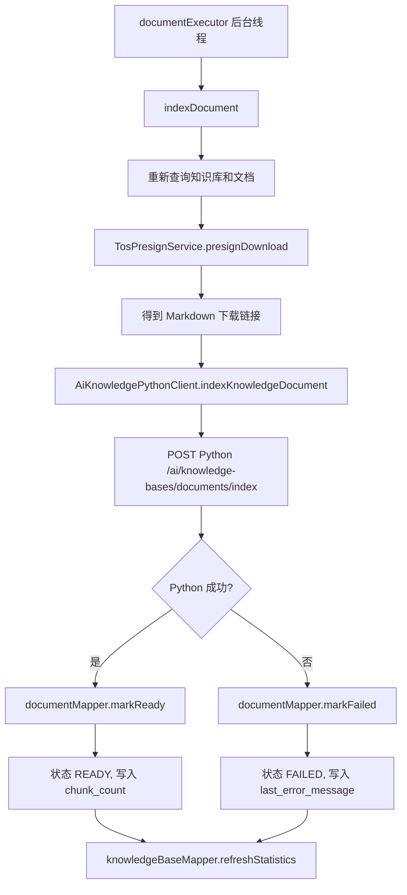

Java 关键方法：

```text
AiKnowledgeDocumentServiceImpl.create
AiKnowledgeDocumentServiceImpl.submitIndexTask
AiKnowledgeDocumentServiceImpl.indexDocument
AiKnowledgePythonClient.indexKnowledgeDocument
AiKnowledgeDocumentMapper.markReady
AiKnowledgeDocumentMapper.markFailed
AiKnowledgeBaseMapper.refreshStatistics
```

Python 文档入库流程：

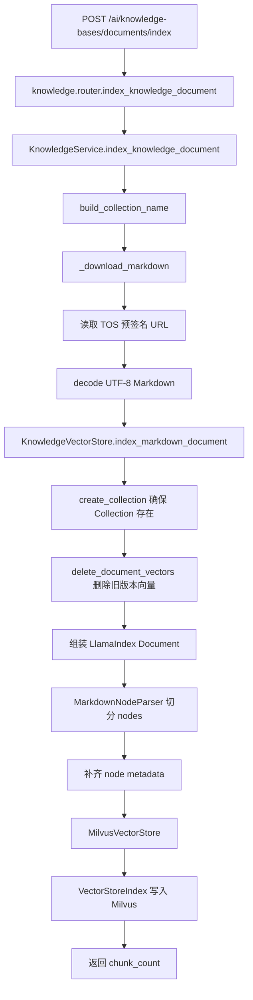

Python 关键方法：

```text
KnowledgeService.index_knowledge_document
KnowledgeService._download_markdown
KnowledgeVectorStore.index_markdown_document
KnowledgeVectorStore.delete_document_vectors
KnowledgeVectorStore._llama_vector_store
KnowledgeVectorStore._embed_model
```

当前文档格式限制：

- 只支持 `.md`。
- objectKey 必须在当前知识库目录下。
- Markdown 内容必须是 UTF-8 编码。

## 7. 文档重建流程

接口：

```http
POST /api/ai/knowledge-bases/{knowledgeBaseId}/documents/{documentId}/rebuild
```

用途：重新下载当前文档、重新切分、覆盖 Milvus 中该文档旧向量。

Java 流程：

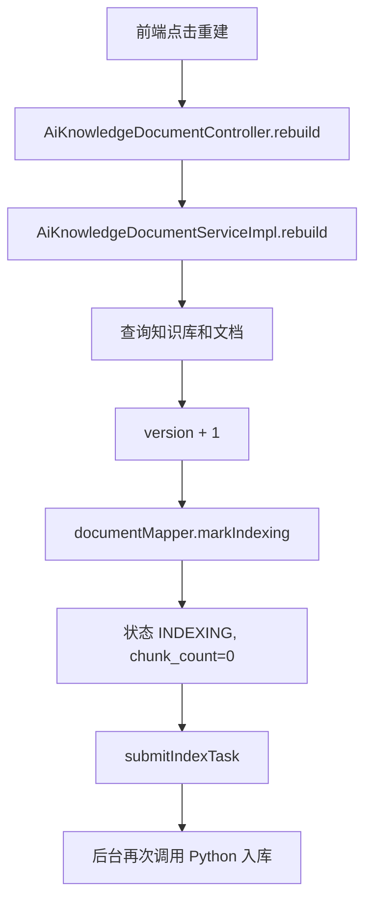

Python 侧与新增文档入库相同。

关键点：Python 入库前会先执行：

```text
delete_document_vectors(collection_name, document_id)
```

因此重建会覆盖同一个文档 ID 的旧向量。

## 8. 查询文档列表流程

接口：

```http
GET /api/ai/knowledge-bases/{knowledgeBaseId}/documents
```

Java 流程：

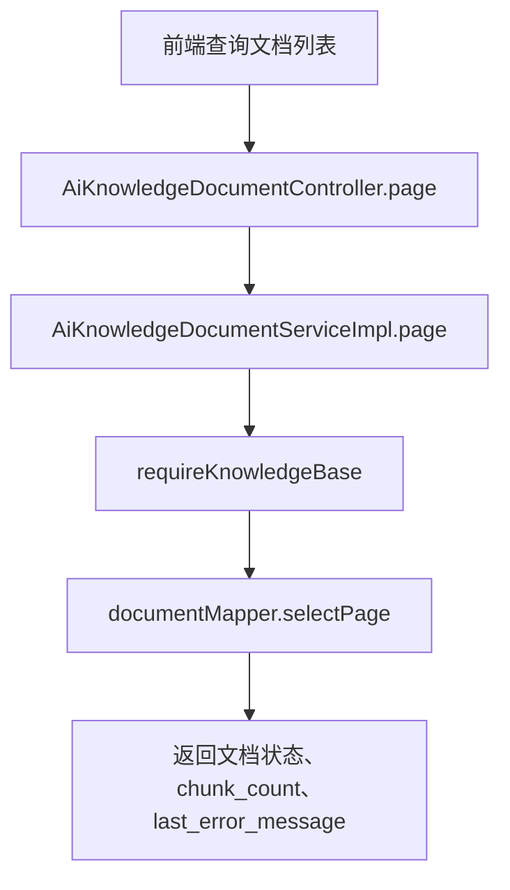

查询只查 MySQL，不调用 Python，不查 Milvus。

文档状态：

| 状态 | 含义 |
| --- | --- |
| `INDEXING` | 正在后台入库 |
| `READY` | 入库成功 |
| `FAILED` | 入库失败，可看 `last_error_message` |

## 9. 删除文档流程

接口：

```http
DELETE /api/ai/knowledge-bases/{knowledgeBaseId}/documents/{documentId}
```

Java 流程：

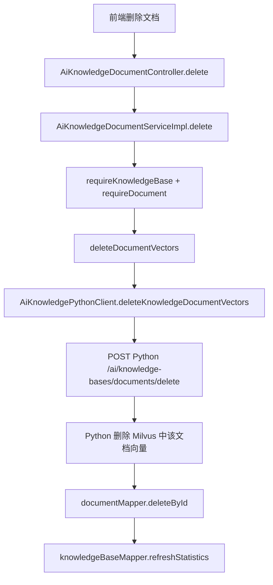

Python 流程：

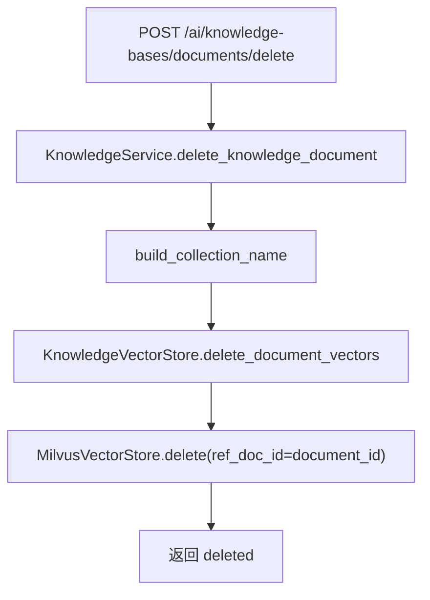

注意：Java 是先删 Milvus，再删 MySQL。Milvus 删除失败时，MySQL 记录会保留，便于排查和重试。

## 10. 删除知识库流程

接口：

```http
DELETE /api/ai/knowledge-bases/{id}
```

Java 流程：

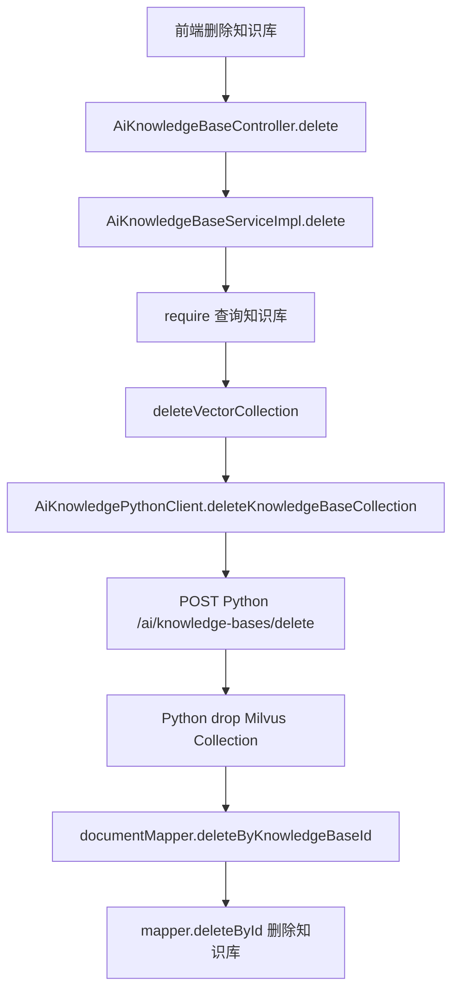

Python 流程：

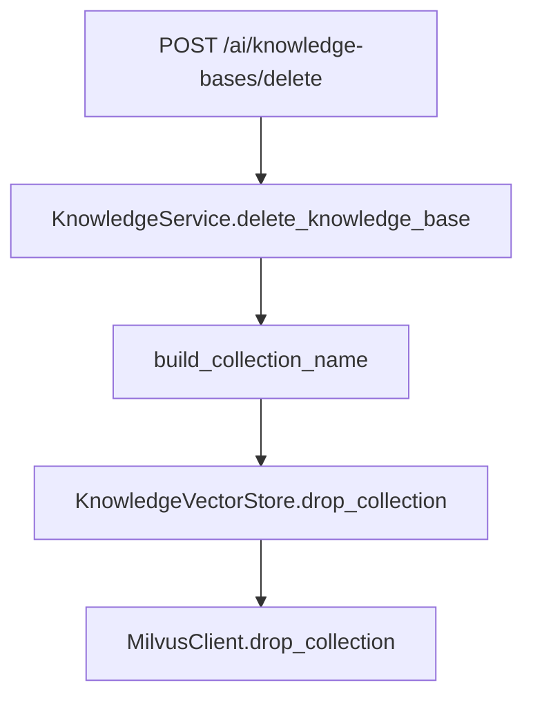

注意：Java 是先删 Milvus Collection，再删 MySQL 知识库和文档记录。

## 11. 启用/禁用知识库流程

接口：

```http
PUT /api/ai/knowledge-bases/{id}/status
```

Java 流程：

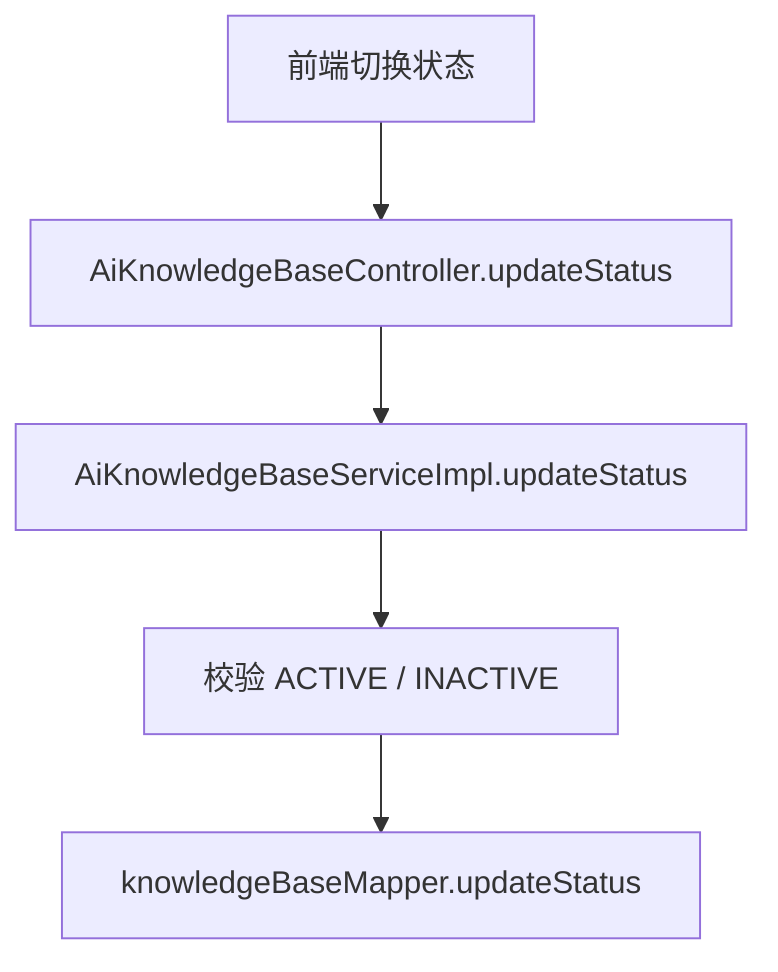

这个操作只更新 MySQL 中的知识库状态，不会调用 Python，也不会删除 Milvus 向量。

当前代码里没有单独的“禁用文档”接口。文档只有：

- 入库中：`INDEXING`
- 完成：`READY`
- 失败：`FAILED`
- 删除：物理删除文档并删除对应向量

如果后续要做“禁用当前文档”，需要新增文档状态和接口，并决定检索时是否过滤禁用文档。

## 12. Python FastAPI 入口

Python 服务启动入口：

```text
YanQue-AI-14/src/yanque_ai/main.py
```

应用组装：

```text
YanQue-AI-14/src/yanque_ai/common/application.py
```

注册的路由包括：

```text
/health
/ai/chat/...
/ai/knowledge-bases/...
```

知识库 Python 接口：

| Python 接口 | 方法 | 说明 |
| --- | --- | --- |
| `/ai/knowledge-bases/create` | POST | 创建或复用 Milvus Collection |
| `/ai/knowledge-bases/delete` | POST | 删除 Milvus Collection |
| `/ai/knowledge-bases/documents/index` | POST | 下载 Markdown，切分并入库 |
| `/ai/knowledge-bases/documents/delete` | POST | 删除某个文档的向量 |

Python 服务启动命令：

```powershell
cd D:\YanQue-AI\YanQue-AI-14
.\start-ai.bat
```

如果不用脚本，等价命令是：

```powershell
cd D:\YanQue-AI\YanQue-AI-14
uv run --cache-dir .uv-cache python -m yanque_ai.main
```

## 13. Python 向量入库核心代码

文件：

```text
YanQue-AI-14/src/yanque_ai/modules/knowledge/vector_store.py
```

核心组件：

| 组件 | 作用 |
| --- | --- |
| `build_collection_name` | 把知识库 code 转成 Milvus 合法 Collection 名 |
| `KnowledgeVectorStore.create_collection` | 创建 Milvus Collection、字段、索引、BM25 Function |
| `KnowledgeVectorStore.index_markdown_document` | Markdown 转 LlamaIndex Document，切分 nodes，写入 Milvus |
| `MarkdownNodeParser` | 按 Markdown 结构切分文档 |
| `OpenAIEmbedding` | 调用百炼 OpenAI 兼容 Embedding 接口生成稠密向量 |
| `MilvusVectorStore` | LlamaIndex 对 Milvus 的写入适配层 |
| `VectorStoreIndex` | 触发 nodes embedding 和向量写入 |

Collection 字段包括：

| 字段 | 说明 |
| --- | --- |
| `id` | Milvus 主键 |
| `doc_id` / `ref_doc_id` | LlamaIndex 文档关联字段 |
| `knowledge_base_id` | Java 知识库 ID |
| `document_id` | 文档 ID |
| `document_code` | 文档编码 |
| `document_name` | 文档名称 |
| `object_key` | TOS 路径 |
| `document_version` | 文档版本 |
| `chunk_index` | 切片序号 |
| `text` | 切片文本 |
| `dense_vector` | 稠密向量 |
| `sparse_vector` | BM25 稀疏向量 |
| `status` | 向量侧状态元数据 |
| `created_at` | 入库时间戳 |
| `metadata` | 额外元数据 JSON |

## 14. 状态与统计更新

文档入库状态更新在 MyBatis Mapper 中：

```text
YanQue-Admin-14/src/main/resources/mapper/aiknowledge/AiKnowledgeDocumentMapper.xml
```

关键 SQL：

| 方法 | 作用 |
| --- | --- |
| `markIndexing` | 重建时把文档置为 `INDEXING`，版本号加一 |
| `markReady` | Python 成功后置为 `READY` 并写入切片数 |
| `markFailed` | Python 失败后置为 `FAILED` 并写入错误信息 |

知识库统计更新在：

```text
YanQue-Admin-14/src/main/resources/mapper/aiknowledge/AiKnowledgeBaseMapper.xml
```

关键方法：

```text
refreshStatistics
```

统计规则：

- `document_count`：当前知识库下 `READY` 文档数量。
- `chunk_count`：当前知识库下 `READY` 文档的 `chunk_count` 总和。

所以失败或正在入库的文档，不计入知识库统计。

## 15. 异常处理链路

Python 异常：

```text
AIServiceError
```

由 FastAPI 统一返回：

```json
{
  "code": "KNOWLEDGE_DOCUMENT_INDEX_FAILED",
  "message": "知识库文档入库失败：..."
}
```

常见 HTTP 状态：

| 状态 | 场景 |
| --- | --- |
| `502` | Milvus、TOS 下载、Embedding 或向量入库失败 |
| `500` | Python 缺少必要配置 |

Java 调 Python 失败时：

- 创建知识库失败：Java 删除刚插入的知识库 MySQL 记录。
- 文档入库失败：Java 把文档状态改成 `FAILED`，保存错误信息。
- 删除文档失败：Java 不删除 MySQL 文档记录。
- 删除知识库失败：Java 不删除 MySQL 知识库和文档记录。

## 16. 当前设计要点

1. 知识库创建是同步调用 Python 的。
   创建接口必须等 Milvus Collection 初始化成功后才返回成功。

2. 文档新增是异步入库的。
   前端新增文档后会先看到 `INDEXING`，稍后查询列表看到 `READY` 或 `FAILED`。

3. Java 是业务事实来源。
   页面展示、状态、切片数、错误信息都读 MySQL。

4. Python 是向量事实来源。
   文档内容切分、Embedding、Milvus 写入都由 Python 负责。

5. 删除操作偏保守。
   删除文档或知识库时，先清理向量侧，再删除 MySQL；向量侧失败就保留 MySQL 数据，方便排查。

6. 当前只支持 Markdown。
   虽然页面文案可能提到 PDF、Word，但代码校验目前只允许 `.md`。

## 17. 排查顺序

如果创建知识库失败：

1. 看 Java 日志中 `AiKnowledgePythonClient.createKnowledgeBaseCollection` 的请求体。
2. 看 Python 服务是否启动在 `localhost:8000`。
3. 看 Python 日志中的 Milvus 错误。
4. 检查知识库 code 是否能转成合法 Collection 名。
5. 检查 Milvus 连接配置。

如果文档一直 `INDEXING`：

1. 看 Java 后台线程是否报错。
2. 看 `ai_knowledge_document.last_error_message` 是否为空。
3. 看 TOS 预签名下载链接是否能下载 Markdown。
4. 看 Python `/ai/knowledge-bases/documents/index` 是否收到请求。
5. 看 Embedding API Key 和 Milvus 写入是否正常。

如果文档 `FAILED`：

1. 先看文档列表返回的 `lastErrorMessage`。
2. 再看 Python 日志。
3. 常见原因是 Markdown 下载失败、文件不是 UTF-8、Milvus Collection schema 不匹配、Embedding 配置缺失。

如果删除失败：

1. 先看 Python 是否能访问 Milvus。
2. 再看 Collection 名是否和创建时一致。
3. 最后检查 Java 是否仍保留 MySQL 记录。

## 18. 一句话记忆

创建知识库：Java 写 MySQL，然后 Python 建 Milvus 表。

上传文件：Java 给 TOS 预签名，前端直接上传。

新增文档：Java 写 MySQL 为 `INDEXING`，后台线程请求 Python 下载 Markdown、切分、入 Milvus，成功后 Java 改 `READY` 并更新切片数。

删除文档：先删 Milvus 文档向量，再删 MySQL 文档。

删除知识库：先删 Milvus Collection，再删 MySQL 文档和知识库。
